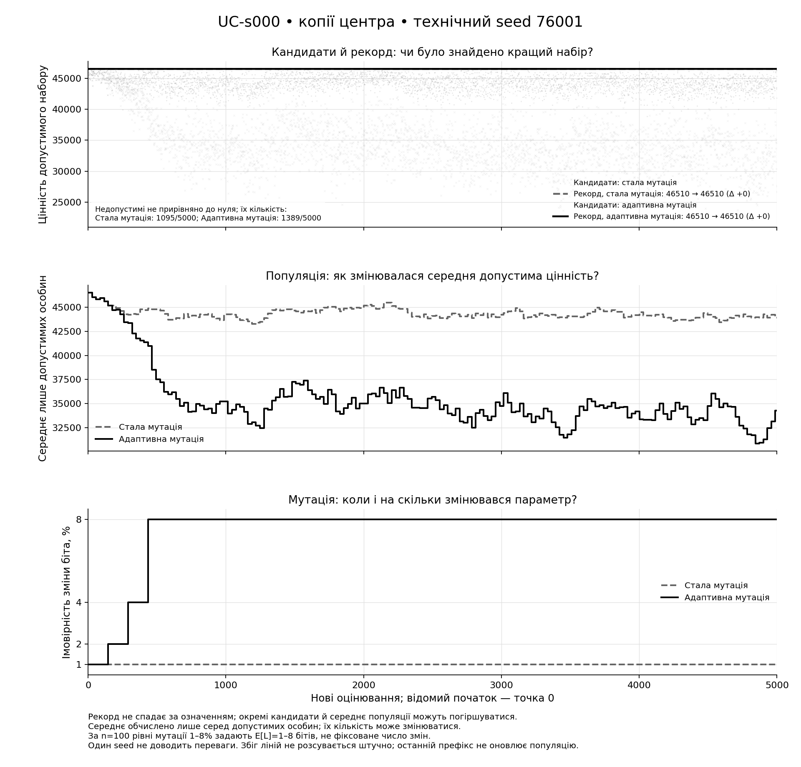
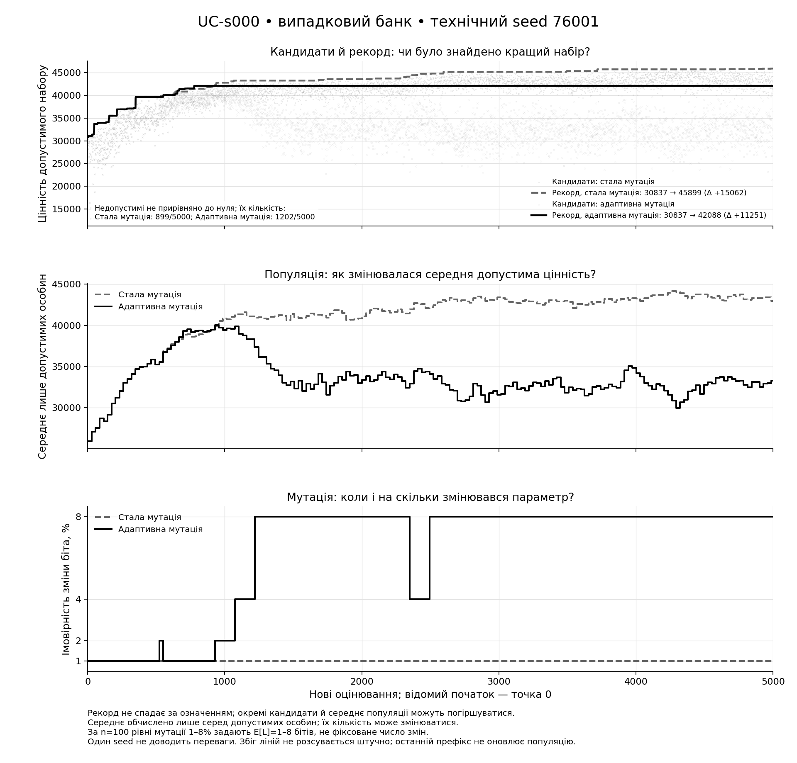

# Власна адаптація лише мутації: технічний пілот

Статус: **16/16 перевірених запусків**, 80 000 нових пошукових оцінювань. Один технічний seed 76001; це перевірка реалізації, не статистична перевірка переваги.

Популяція стала: 30 особин; схрещування стале: 0,9. Лише власний контролер мутації змінює її ймовірність після завершеного покоління. Правило не є відтворенням статті або адаптацією λ.

## Що сталося з рекордом?

У рядках `cloned` поліпшення означає вихід вище збереженого центра, крім SC-s000: це глобальний негативний контроль. У рядках `bank` це поліпшення початкового рекорду випадкового банку, а не доведений вихід із локального максимуму.

| Задача | Початок | Метод | Початковий рекорд | Кінцевий рекорд | Приріст | Перше поліпшення, запит |
| --- | --- | --- | ---: | ---: | ---: | --- |
| UC-s000 | копії центра | Стала мутація | 46510 | 46510 | +0 | немає до 5000 |
| UC-s000 | копії центра | Адаптивна мутація | 46510 | 46510 | +0 | немає до 5000 |
| UC-s000 | випадковий банк | Стала мутація | 30837 | 45899 | +15062 | 4 |
| UC-s000 | випадковий банк | Адаптивна мутація | 30837 | 42088 | +11251 | 4 |
| WC-s001 | копії центра | Стала мутація | 27585 | 27585 | +0 | немає до 5000 |
| WC-s001 | копії центра | Адаптивна мутація | 27585 | 27585 | +0 | немає до 5000 |
| WC-s001 | випадковий банк | Стала мутація | 24808 | 26811 | +2003 | 10 |
| WC-s001 | випадковий банк | Адаптивна мутація | 24808 | 26125 | +1317 | 10 |
| SC-s005 | копії центра | Стала мутація | 31841 | 31841 | +0 | немає до 5000 |
| SC-s005 | копії центра | Адаптивна мутація | 31841 | 31841 | +0 | немає до 5000 |
| SC-s005 | випадковий банк | Стала мутація | 28798 | 30932 | +2134 | 23 |
| SC-s005 | випадковий банк | Адаптивна мутація | 28798 | 30293 | +1495 | 23 |
| SC-s000 | копії центра | Стала мутація | 35617 | 35617 | +0 | глобальний контроль: немає |
| SC-s000 | копії центра | Адаптивна мутація | 35617 | 35617 | +0 | глобальний контроль: немає |
| SC-s000 | випадковий банк | Стала мутація | 33769 | 34914 | +1145 | 82 |
| SC-s000 | випадковий банк | Адаптивна мутація | 33769 | 34408 | +639 | 82 |

*Невиходи не вилучено. Для них обмежене число запитів дорівнює 5000; вихід саме на запиті 5000 має той самий час, але інший прапорець події. Відсутність поліпшення не встановлює глобальності: глобальні позначки походять лише із зовнішніх точних доказів.*

## Як працював контролер і на що витрачалися оцінювання?

«Сигнали успіху» — завершені покоління зі строгим зростанням допустимого рекорду. Подвоєння — спрацювання порога п'яти поколінь; на верхній межі воно може не змінювати ймовірність. Фактичні підвищення й зниження наведено окремо.

| Задача | Початок | Метод | Повтори масок | Недопустимі | Сигнали успіху | Подвоєння: тригери | Фактичні ↑ / ↓ | Кінцева мутація, % |
| --- | --- | --- | ---: | ---: | ---: | ---: | ---: | ---: |
| UC-s000 | копії центра | Стала мутація | 702 | 1095 | 0 | 0 | 0 / 0 | 1.00 |
| UC-s000 | копії центра | Адаптивна мутація | 48 | 1389 | 0 | 34 | 3 / 0 | 8.00 |
| UC-s000 | випадковий банк | Стала мутація | 329 | 899 | 37 | 0 | 0 / 0 | 1.00 |
| UC-s000 | випадковий банк | Адаптивна мутація | 62 | 1202 | 17 | 29 | 5 / 2 | 8.00 |
| WC-s001 | копії центра | Стала мутація | 367 | 1218 | 0 | 0 | 0 / 0 | 1.00 |
| WC-s001 | копії центра | Адаптивна мутація | 45 | 1531 | 0 | 34 | 3 / 0 | 8.00 |
| WC-s001 | випадковий банк | Стала мутація | 245 | 1165 | 18 | 0 | 0 / 0 | 1.00 |
| WC-s001 | випадковий банк | Адаптивна мутація | 48 | 1419 | 8 | 29 | 9 / 6 | 8.00 |
| SC-s005 | копії центра | Стала мутація | 374 | 1175 | 0 | 0 | 0 / 0 | 1.00 |
| SC-s005 | копії центра | Адаптивна мутація | 47 | 1480 | 0 | 34 | 3 / 0 | 8.00 |
| SC-s005 | випадковий банк | Стала мутація | 319 | 1295 | 15 | 0 | 0 / 0 | 1.00 |
| SC-s005 | випадковий банк | Адаптивна мутація | 26 | 1396 | 6 | 32 | 4 / 1 | 8.00 |
| SC-s000 | копії центра | Стала мутація | 392 | 1165 | 0 | 0 | 0 / 0 | 1.00 |
| SC-s000 | копії центра | Адаптивна мутація | 54 | 1504 | 0 | 34 | 3 / 0 | 8.00 |
| SC-s000 | випадковий банк | Стала мутація | 265 | 1125 | 14 | 0 | 0 / 0 | 1.00 |
| SC-s000 | випадковий банк | Адаптивна мутація | 53 | 1445 | 10 | 28 | 7 / 4 | 8.00 |

Кожний рядок має рівно 5000 нових оцінювань: 172 повні покоління по 29 дітей та останні 12 дітей. Дублікати й недопустимі маски теж витрачають запит. Останні 12 дітей можуть поліпшити рекорд, але не змінюють популяції або контролера.

*Сигнал успіху на нижній межі може не зменшити мутацію. E[L]=np_m — математичне сподівання, не обіцянка саме такого числа змінених бітів. Початкова підготовка, 30 внутрішніх перевірок відомих оцінок на запуск та незалежні перевірні оцінювання обліковуються окремо від 80 000 нових пошукових запитів.*

## Два наперед обрані рисунки UC-s000

[Двосторінковий PDF](Прості_графіки_мутації.pdf)

На верхній панелі — усі допустимі кандидати та окремо рекорд; недопустимим не присвоєно нульової цінності. Середня панель показує лише фактичну популяцію, а не середнє всіх кандидатів. Нижня — ймовірність мутації, застосовану до відповідних запитів; оновлення після покоління діє на наступне.

*Монотонність рекорду є властивістю збереження найкращого результату. Плоскі або збіжні лінії не приховано. Рисунки не мають довірчих смуг: одна технічна реалізація не оцінює міжзапускову невизначеність і не доводить кореляції, причинності або переваги.*

## Межі результату

Підтверджено лише технічну повноту й незалежну перевірку журналів у зареєстрованих умовах. Пілот не відокремлює користь feedback від ефекту іншого середнього рівня мутації; таке питання потребує окремого погодженого порівняння. Параметри не налаштовано за його результатами.

*Немає нової перевірки статистичної переваги, бутстрепу, універсального прискорення або встановленої новизни. Гірші діти можуть входити до неелітних місць поколіннєвого ГА; старе твердження про відкидання всіх одно- й двобітних відхилень у `(μ+1)` ГА сюди не переноситься. Контролер не діагностує локальність чи глобальність.*

## Походження

Протокол: `GA-ADAPTIVE-MUTATION-ONLY-TECHNICAL-V1`. Реєстраційний коміт: `23014ffd96cc479ce6e90f237a62fc88f76f38b8`. SHA реалізації: `9d09e17860ebcac63f46b4e3ce1769cb7516f5d3`; CI run `38803843897`, attempt `1`.

Числові описи й ідентичності журналів: `report_descriptives.json`; первинні технічні підсумки: `pilot_summary.json`; повні журнали: `journals/`. Нових пошукових запусків або точних розв'язань під час оформлення звіту не виконано.
