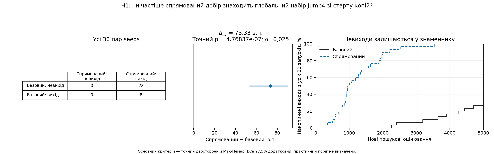
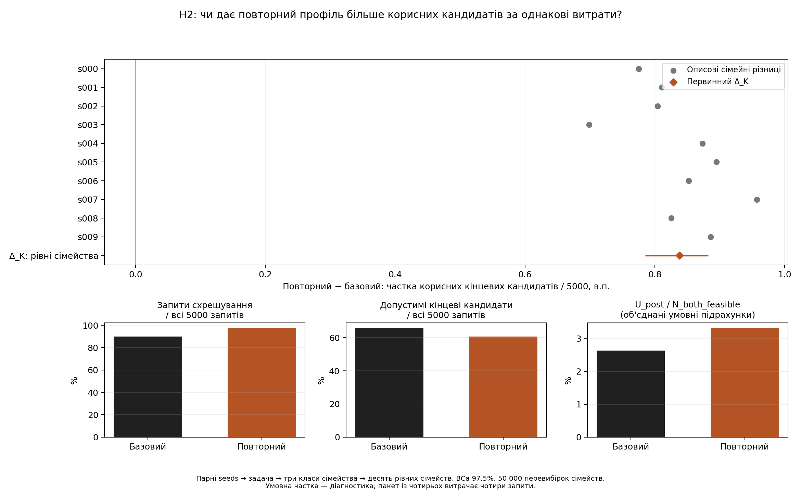
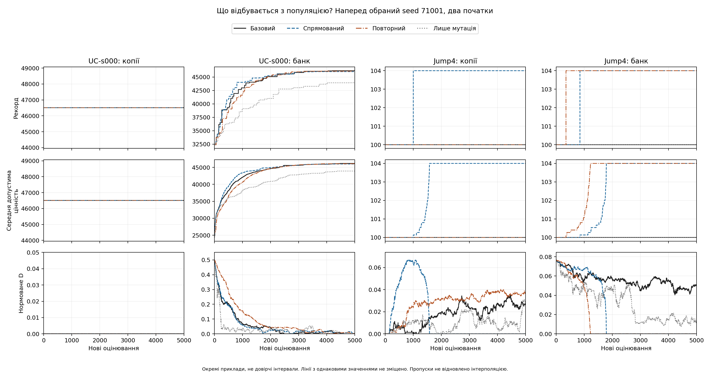

# Основне порівняння добору батьків і повторного схрещування

Протокол GA-DIVERSITY-CROSSOVER-MAIN-V1. Статус: COMPLETE_MAIN.

Повні незалежно перевірені запуски: 6304/6304; нові пошукові оцінювання: 31,520,000.

## H1: вихід на Jump4 зі старту копій

| Базовий метод | Спрямований: невихід | Спрямований: вихід |
| --- | ---: | ---: |
| Невихід | 0 | 22 |
| Вихід | 0 | 8 |

Δ_J = 73.3333 в.п.; точний двосторонній p = 4.7683716e-07, α=0,025. Додатковий 97,5% BCa: [53.3333; 90.0000] в.п..

Зареєстрований точний критерій дає номінальне свідчення вищої частоти виходу спрямованого методу на Jump4 у цих умовах.

Одиниця аналізу — ціла парна реалізація seed; запити всередині запуску не є незалежними спостереженнями.

## H2: корисні кінцеві кандидати за однаковий бюджет

Δ_K = 0.8378 в.п.; 97,5% BCa: [0.7855; 0.8822] в.п..

Нижня межа зареєстрованого інтервалу перевищує нуль: є номінальне свідчення переваги повторного профілю за цим показником на обраному наборі.

U_post рахує допустимих кінцевих нащадків гілки схрещування, строго кращих за обох допустимих батьків. Знаменник — усі 5000 нових запитів; враховано невибраних нащадків і останній префікс. Ефект стосується повного повторного профілю, частка запитів схрещування й кількість замін якого відрізняються. U_post може включати користь мутації й не ізолює причинний ефект схрещування.

| Сімейство | Задачі | Повторний − базовий, в.п. |
| --- | --- | ---: |
| s000 | SC-s000, UC-s000, WC-s000 | 0.7751 |
| s001 | SC-s001, UC-s001, WC-s001 | 0.8107 |
| s002 | SC-s002, UC-s002, WC-s002 | 0.8044 |
| s003 | SC-s003, UC-s003, WC-s003 | 0.6989 |
| s004 | SC-s004, UC-s004, WC-s004 | 0.8731 |
| s005 | SC-s005, UC-s005, WC-s005 | 0.8951 |
| s006 | SC-s006, UC-s006, WC-s006 | 0.8522 |
| s007 | SC-s007, UC-s007, WC-s007 | 0.9573 |
| s008 | SC-s008, UC-s008, WC-s008 | 0.8253 |
| s009 | SC-s009, UC-s009, WC-s009 | 0.8858 |

Парні seeds усереднено до задачі, три класи до сімейства, десять сімейств мають рівні ваги. 50 000 перевибірок і jackknife вилучають цілі сімейства. Десять сімейств не гарантують незалежності чи представлення всіх задач рюкзака.

## Діагностика знаменників

| Метод | U_post / всі запити, % | Запити схрещування, % | Допустимі кандидати, % | Умовна U_post / N_both_feasible, % |
| --- | ---: | ---: | ---: | ---: |
| Базовий | 2.3589 | 89.9939 | 65.6276 | 2.6269 |
| Спрямований | 2.3932 | 89.9939 | 65.2750 | 2.6651 |
| Повторний | 3.1967 | 97.2810 | 60.5697 | 3.3059 |
| Лише мутація | 0.0000 | 0.0000 | 72.5570 | не застосовується |

Перші три частки мають рівні сімейні ваги. Умовна частка об'єднує чисельники й знаменники й залишається діагностикою; нульовий знаменник означає NOT_APPLICABLE. U_pre оцінено після пошуку й не включено до нових пошукових запитів.

## Локальні центри: лише описові результати

| Метод | Абсолютні виходи | Рівно-сімейна частота, % | Сімейно-зважене обмежене число запитів | Строгі центри: виходи | SC-s005-плато: виходи |
| --- | ---: | ---: | ---: | ---: | ---: |
| Базовий | 0 / 420 | 0.0000 | 5000.00 | 0 / 390 | 0 / 30 |
| Спрямований | 0 / 420 | 0.0000 | 5000.00 | 0 / 390 | 0 / 30 |
| Повторний | 0 / 420 | 0.0000 | 5000.00 | 0 / 390 | 0 / 30 |
| Лише мутація | 0 / 420 | 0.0000 | 5000.00 | 0 / 390 | 0 / 30 |

Невихід має T=5000 та окремий прапорець цензурування; вихід на запиті 5000 має те саме T, але інший статус. Нерівна кількість локальних задач у сімействах дозволяє загальній частці й сімейній оцінці різнитися. Невихід не доводить глобальності; для одного плато окремого тесту немає.

## Наперед обрані траєкторії

Обидва початки й усі методи показано без штучного зміщення ліній. Це приклади, не довірчі інтервали; відсутні дані не інтерполюються.

## Межі висновків і числовий додаток

Є лише дві первинні статистичні заяви. Інші початки, Jump8, OneMax, Flat, глобальні контролі й порівняння описові без додаткових p-значень. Для Flat зростання якості не оцінюється. Пілотний seed 70001 не включено. Практичні пороги не визначено: практично значущу або універсальну перевагу не заявлено; 30 seeds не гарантують потужності.

Параметри цього дослідження сталі; адаптації λ немає. Воно не є завершеною реплікацією статей і не встановлює нового алгоритму. Банк і клони відрізняються одночасно якістю, різноманітністю та локальністю й не ізолюють вплив D.

analysis.json містить первинні оцінки, всі парні різниці, сімейні ваги й описові групи. run-metrics.csv містить усі 6304 фізичні запуски, включно з 64 глобальними контролями. Повні журнали, свідки й хеші — у джерельних пакетах; підготовчі й перевірні оцінювання та runner-хвилини обліковуються окремо.
