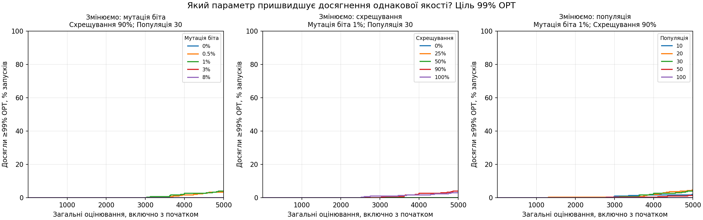
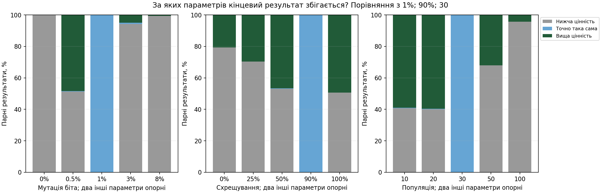
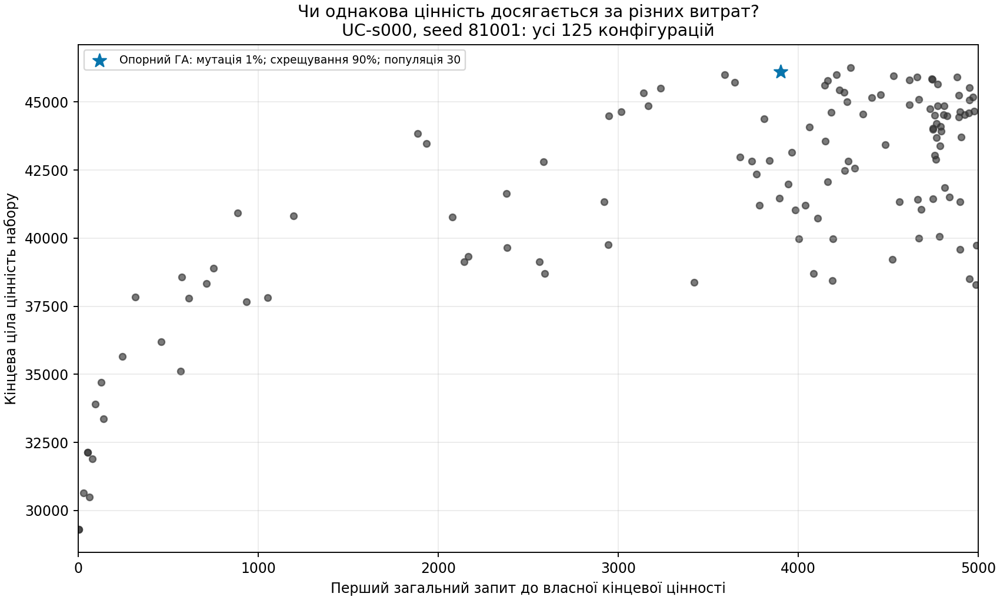

# Параметри ГА: результат і витрати

## Скільки оцінювань потрібно до однакової якості?

Основний рисунок speed-target-99.png показує частку запусків, які вже досягли 99% точного оптимуму. Вона усереднена за повтореннями, задачами та рівноважними сімействами. Невиходи залишаються в знаменнику; недосягнення не перетворюється на досягнення на запиті 5000. Рисунки для 95% і 100% — перевірка чутливості, не вибір вигідного порогу.

Вища лінія за однакової кількості оцінювань означає більше досягнень спільної цілі. Якщо лінії перетинаються, єдиного найшвидшого налаштування для всіх витрат немає. Плоска нульова лінія означає, що жоден запуск не досяг цієї цілі, а не відсутність даних.

## За яких налаштувань цінність збігається?

Кожну конфігурацію порівняно з опорною на тій самій задачі й seed: вища, точно однакова або нижча ціла кінцева цінність. Графік змінює один параметр; решта два — опорні. Повні 125 конфігурацій і абсолютні кількості пар збережено в speed_analysis.json. Це точні збіги спостережуваних значень, не тест статистичної еквівалентності й не гарантія однакових масок.

## Чи можна одержати ту саму цінність раніше?

Показано всі 125 конфігурацій наперед обраного прикладу UC-s000, seed 81001. Горизонтальний рівень об'єднує однакові кінцеві цінності; кожна точка — конфігурація, збіги координат можуть накладатися. Повний склад груп і три параметри кожної точки є в JSON. Швидкий прихід до гіршої власної цінності не означає швидшого досягнення спільної якості: для цього потрібен попередній рисунок з OPT.

## Короткі відповіді за конфігураціями

| Мутація біта, % | Схрещування, % | Популяція | Досягли 99% OPT, % | Точно як опорний, % | Вище / нижче, % |
|---:|---:|---:|---:|---:|---:|
| 0 | 0 | 10 | 0.00 | 0.00 | 0.00 / 100.00 |
| 0 | 0 | 20 | 0.00 | 0.00 | 0.00 / 100.00 |
| 0 | 0 | 30 | 0.00 | 0.00 | 0.00 / 100.00 |
| 0 | 0 | 50 | 0.00 | 0.00 | 0.00 / 100.00 |
| 0 | 0 | 100 | 0.00 | 0.00 | 0.00 / 100.00 |
| 0 | 25 | 10 | 0.00 | 0.00 | 0.00 / 100.00 |
| 0 | 25 | 20 | 0.00 | 0.00 | 0.00 / 100.00 |
| 0 | 25 | 30 | 0.00 | 0.00 | 0.00 / 100.00 |
| 0 | 25 | 50 | 0.00 | 0.00 | 0.00 / 100.00 |
| 0 | 25 | 100 | 0.00 | 0.00 | 0.33 / 99.67 |
| 0 | 50 | 10 | 0.00 | 0.00 | 0.00 / 100.00 |
| 0 | 50 | 20 | 0.00 | 0.00 | 0.00 / 100.00 |
| 0 | 50 | 30 | 0.00 | 0.00 | 0.00 / 100.00 |
| 0 | 50 | 50 | 0.00 | 0.00 | 0.00 / 100.00 |
| 0 | 50 | 100 | 0.00 | 0.00 | 2.33 / 97.67 |
| 0 | 90 | 10 | 0.00 | 0.00 | 0.00 / 100.00 |
| 0 | 90 | 20 | 0.00 | 0.00 | 0.33 / 99.67 |
| 0 | 90 | 30 | 0.00 | 0.00 | 0.00 / 100.00 |
| 0 | 90 | 50 | 0.00 | 0.33 | 4.00 / 95.67 |
| 0 | 90 | 100 | 3.67 | 0.00 | 26.00 / 74.00 |
| 0 | 100 | 10 | 0.00 | 0.00 | 0.00 / 100.00 |
| 0 | 100 | 20 | 0.00 | 0.00 | 0.00 / 100.00 |
| 0 | 100 | 30 | 0.00 | 0.00 | 0.00 / 100.00 |
| 0 | 100 | 50 | 0.00 | 0.00 | 5.00 / 95.00 |
| 0 | 100 | 100 | 4.33 | 0.00 | 27.00 / 73.00 |
| 0.5 | 0 | 10 | 0.00 | 0.00 | 2.33 / 97.67 |
| 0.5 | 0 | 20 | 0.00 | 0.00 | 3.33 / 96.67 |
| 0.5 | 0 | 30 | 0.00 | 0.00 | 2.00 / 98.00 |
| 0.5 | 0 | 50 | 0.00 | 0.00 | 1.00 / 99.00 |
| 0.5 | 0 | 100 | 0.00 | 0.00 | 0.00 / 100.00 |
| 0.5 | 25 | 10 | 0.00 | 0.33 | 2.67 / 97.00 |
| 0.5 | 25 | 20 | 0.00 | 0.00 | 5.67 / 94.33 |
| 0.5 | 25 | 30 | 0.00 | 0.00 | 7.67 / 92.33 |
| 0.5 | 25 | 50 | 0.00 | 0.33 | 7.00 / 92.67 |
| 0.5 | 25 | 100 | 0.00 | 0.00 | 3.33 / 96.67 |
| 0.5 | 50 | 10 | 0.00 | 0.00 | 5.00 / 95.00 |
| 0.5 | 50 | 20 | 0.33 | 0.00 | 16.00 / 84.00 |
| 0.5 | 50 | 30 | 0.67 | 0.00 | 20.33 / 79.67 |
| 0.5 | 50 | 50 | 1.33 | 0.67 | 27.33 / 72.00 |
| 0.5 | 50 | 100 | 0.33 | 0.00 | 14.00 / 86.00 |
| 0.5 | 90 | 10 | 0.00 | 0.00 | 9.00 / 91.00 |
| 0.5 | 90 | 20 | 1.67 | 0.00 | 31.00 / 69.00 |
| 0.5 | 90 | 30 | 3.67 | 0.33 | 48.33 / 51.33 |
| 0.5 | 90 | 50 | 8.33 | 0.67 | 50.67 / 48.67 |
| 0.5 | 90 | 100 | 0.33 | 0.33 | 17.00 / 82.67 |
| 0.5 | 100 | 10 | 0.00 | 0.33 | 13.00 / 86.67 |
| 0.5 | 100 | 20 | 1.00 | 0.67 | 36.67 / 62.67 |
| 0.5 | 100 | 30 | 5.00 | 0.67 | 52.00 / 47.33 |
| 0.5 | 100 | 50 | 9.33 | 0.33 | 50.67 / 49.00 |
| 0.5 | 100 | 100 | 1.00 | 0.00 | 19.67 / 80.33 |
| 1 | 0 | 10 | 0.33 | 1.00 | 34.33 / 64.67 |
| 1 | 0 | 20 | 0.00 | 0.00 | 28.33 / 71.67 |
| 1 | 0 | 30 | 0.00 | 0.00 | 20.67 / 79.33 |
| 1 | 0 | 50 | 0.00 | 0.33 | 9.67 / 90.00 |
| 1 | 0 | 100 | 0.00 | 0.33 | 2.33 / 97.33 |
| 1 | 25 | 10 | 1.00 | 0.67 | 37.67 / 61.67 |
| 1 | 25 | 20 | 0.00 | 0.00 | 34.33 / 65.67 |
| 1 | 25 | 30 | 0.00 | 0.00 | 29.67 / 70.33 |
| 1 | 25 | 50 | 0.00 | 0.00 | 20.33 / 79.67 |
| 1 | 25 | 100 | 0.00 | 0.00 | 7.00 / 93.00 |
| 1 | 50 | 10 | 0.33 | 0.33 | 51.00 / 48.67 |
| 1 | 50 | 20 | 0.33 | 0.00 | 50.67 / 49.33 |
| 1 | 50 | 30 | 0.00 | 0.33 | 46.67 / 53.00 |
| 1 | 50 | 50 | 0.00 | 0.00 | 26.00 / 74.00 |
| 1 | 50 | 100 | 0.00 | 0.00 | 5.00 / 95.00 |
| 1 | 90 | 10 | 2.00 | 0.33 | 59.00 / 40.67 |
| 1 | 90 | 20 | 4.67 | 0.33 | 59.67 / 40.00 |
| 1 | 90 | 30 | 4.00 | 100.00 | 0.00 / 0.00 |
| 1 | 90 | 50 | 1.33 | 0.00 | 32.00 / 68.00 |
| 1 | 90 | 100 | 0.00 | 0.00 | 4.33 / 95.67 |
| 1 | 100 | 10 | 4.33 | 0.33 | 62.33 / 37.33 |
| 1 | 100 | 20 | 4.67 | 0.00 | 58.33 / 41.67 |
| 1 | 100 | 30 | 3.00 | 0.00 | 49.33 / 50.67 |
| 1 | 100 | 50 | 1.33 | 0.00 | 26.00 / 74.00 |
| 1 | 100 | 100 | 0.00 | 0.00 | 4.67 / 95.33 |
| 3 | 0 | 10 | 0.00 | 0.00 | 28.00 / 72.00 |
| 3 | 0 | 20 | 0.00 | 0.67 | 15.00 / 84.33 |
| 3 | 0 | 30 | 0.00 | 0.00 | 11.67 / 88.33 |
| 3 | 0 | 50 | 0.00 | 0.33 | 5.00 / 94.67 |
| 3 | 0 | 100 | 0.00 | 0.00 | 1.67 / 98.33 |
| 3 | 25 | 10 | 0.00 | 0.00 | 28.33 / 71.67 |
| 3 | 25 | 20 | 0.00 | 0.00 | 17.33 / 82.67 |
| 3 | 25 | 30 | 0.00 | 0.00 | 6.33 / 93.67 |
| 3 | 25 | 50 | 0.00 | 0.00 | 2.67 / 97.33 |
| 3 | 25 | 100 | 0.00 | 0.33 | 1.33 / 98.33 |
| 3 | 50 | 10 | 0.00 | 0.00 | 26.67 / 73.33 |
| 3 | 50 | 20 | 0.00 | 0.33 | 12.00 / 87.67 |
| 3 | 50 | 30 | 0.00 | 0.33 | 7.00 / 92.67 |
| 3 | 50 | 50 | 0.00 | 0.00 | 3.67 / 96.33 |
| 3 | 50 | 100 | 0.00 | 0.00 | 0.67 / 99.33 |
| 3 | 90 | 10 | 0.00 | 0.00 | 25.33 / 74.67 |
| 3 | 90 | 20 | 0.00 | 0.00 | 8.00 / 92.00 |
| 3 | 90 | 30 | 0.00 | 0.67 | 5.00 / 94.33 |
| 3 | 90 | 50 | 0.00 | 0.00 | 1.67 / 98.33 |
| 3 | 90 | 100 | 0.00 | 0.00 | 0.00 / 100.00 |
| 3 | 100 | 10 | 0.00 | 0.33 | 24.67 / 75.00 |
| 3 | 100 | 20 | 0.00 | 0.00 | 7.00 / 93.00 |
| 3 | 100 | 30 | 0.00 | 0.00 | 3.67 / 96.33 |
| 3 | 100 | 50 | 0.00 | 0.33 | 0.67 / 99.00 |
| 3 | 100 | 100 | 0.00 | 0.00 | 0.00 / 100.00 |
| 8 | 0 | 10 | 0.00 | 0.00 | 6.67 / 93.33 |
| 8 | 0 | 20 | 0.00 | 0.00 | 1.33 / 98.67 |
| 8 | 0 | 30 | 0.00 | 0.33 | 1.00 / 98.67 |
| 8 | 0 | 50 | 0.00 | 0.00 | 0.00 / 100.00 |
| 8 | 0 | 100 | 0.00 | 0.00 | 1.33 / 98.67 |
| 8 | 25 | 10 | 0.00 | 0.00 | 5.67 / 94.33 |
| 8 | 25 | 20 | 0.00 | 0.00 | 2.00 / 98.00 |
| 8 | 25 | 30 | 0.00 | 0.00 | 0.67 / 99.33 |
| 8 | 25 | 50 | 0.00 | 0.00 | 0.33 / 99.67 |
| 8 | 25 | 100 | 0.00 | 0.00 | 0.00 / 100.00 |
| 8 | 50 | 10 | 0.00 | 0.00 | 4.67 / 95.33 |
| 8 | 50 | 20 | 0.00 | 0.00 | 1.33 / 98.67 |
| 8 | 50 | 30 | 0.00 | 0.00 | 0.00 / 100.00 |
| 8 | 50 | 50 | 0.00 | 0.00 | 0.33 / 99.67 |
| 8 | 50 | 100 | 0.00 | 0.00 | 0.00 / 100.00 |
| 8 | 90 | 10 | 0.00 | 0.00 | 3.67 / 96.33 |
| 8 | 90 | 20 | 0.00 | 0.00 | 0.33 / 99.67 |
| 8 | 90 | 30 | 0.00 | 0.00 | 0.67 / 99.33 |
| 8 | 90 | 50 | 0.00 | 0.00 | 0.00 / 100.00 |
| 8 | 90 | 100 | 0.00 | 0.00 | 0.00 / 100.00 |
| 8 | 100 | 10 | 0.00 | 0.00 | 3.33 / 96.67 |
| 8 | 100 | 20 | 0.00 | 0.00 | 0.33 / 99.67 |
| 8 | 100 | 30 | 0.00 | 0.00 | 0.33 / 99.67 |
| 8 | 100 | 50 | 0.00 | 0.00 | 0.00 / 100.00 |
| 8 | 100 | 100 | 0.00 | 0.00 | 0.00 / 100.00 |

*Лише дослідницька стала сітка. Попередній відбір переможця, невідомі пошукові результати нових задач, адаптивний контролер, перевірка переваги та статистична еквівалентність тут не оцінюються. Початкові оцінювання входять до витрат: більша популяція вже спочатку переглядає більше масок.*
