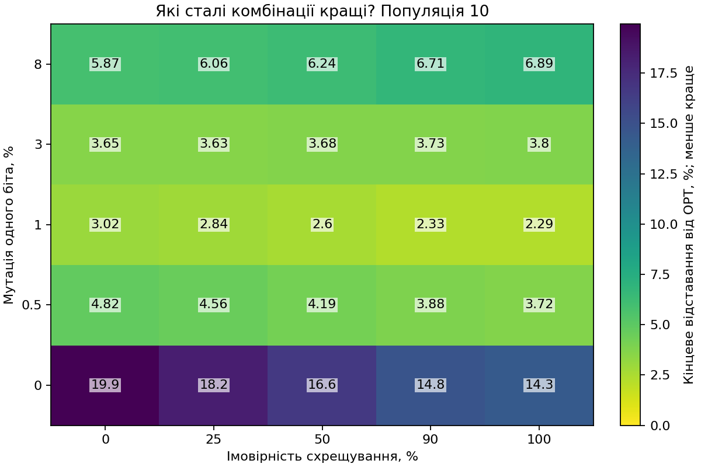
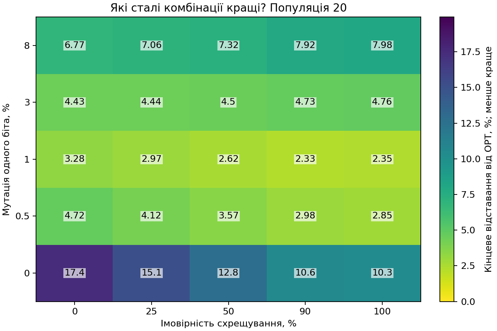
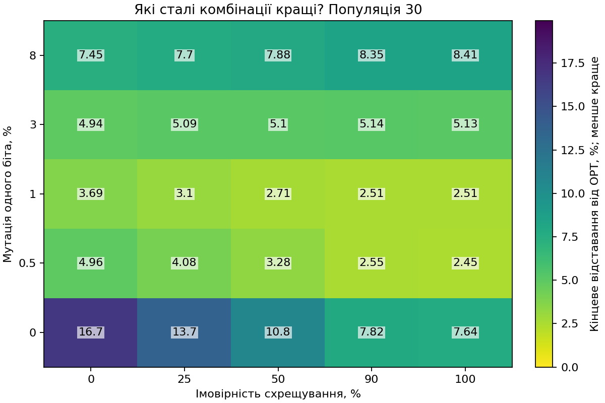
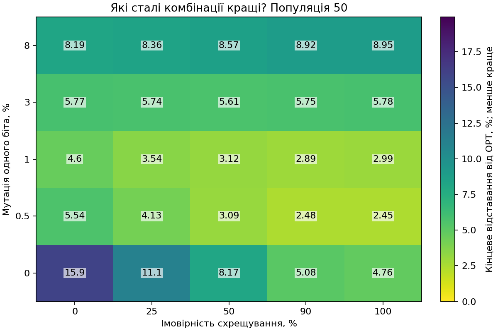
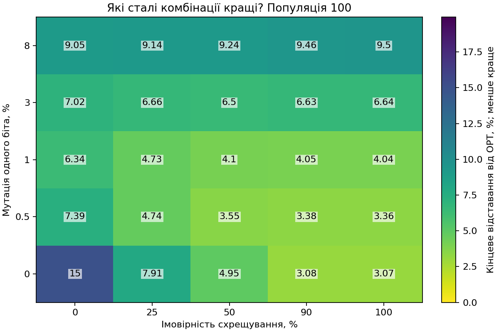
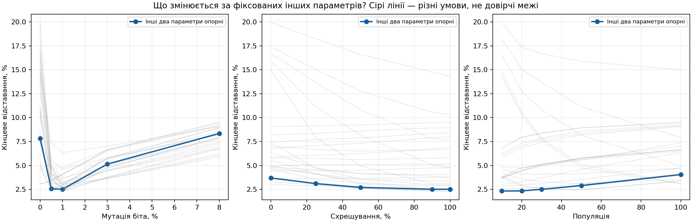
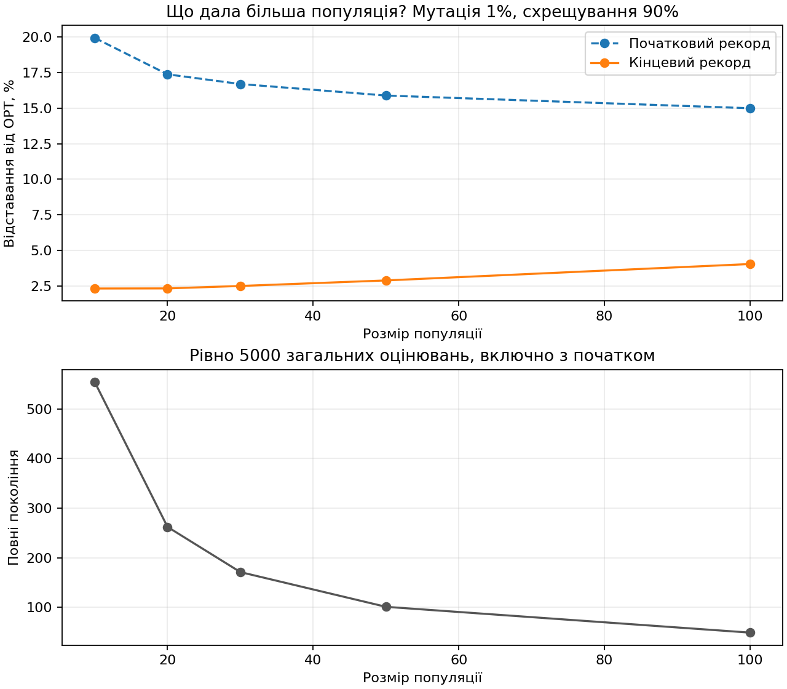
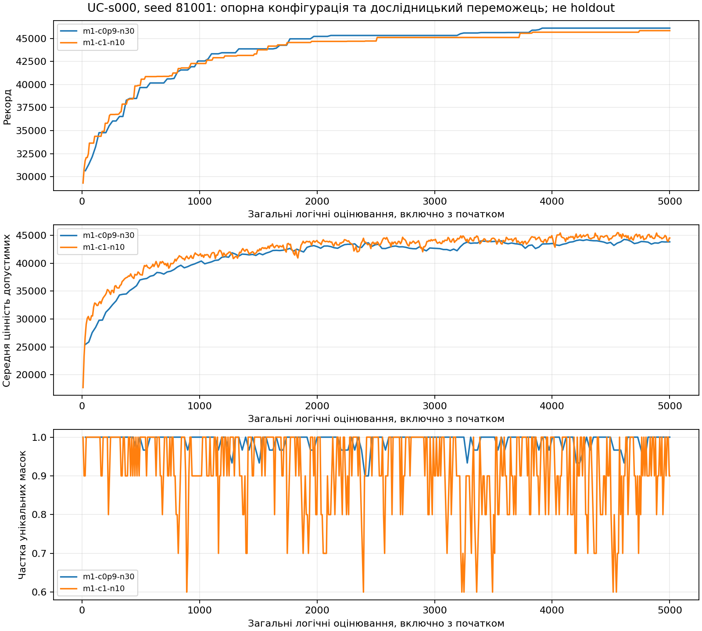

# Сталі параметри: дослідницька сітка, не остаточний тест

Перевірено 37500 запусків, 187500000 загальних логічних оцінювань; 125 конфігурацій, 30 задач, 10 сімейств.

## Яка комбінація обрана?

m1-c1-n10: мутація 1%, схрещування 100%, популяція 10. Середнє відставання 2.28691%. Вибір виконано точними раціональними числами за зареєстрованими нічиїми.

Це найкраща точка цієї дослідницької сітки за цим критерієм, не універсальний оптимум і не оцінка переваги на нових задачах.

## Як впливають три параметри?

Теплові карти мають спільну шкалу. Кожна умовна крива змінює один параметр, фіксуючи решту двох; менше відставання краще. Описові різниці від опорного рівня й Спірмен з середніми рангами збережено в analysis.json. Сталий ряд має UNDEFINED, не нульову кореляцію. Коефіцієнт використовує п'ять умовних середніх, не 37500 незалежних задач; p-значень і нових тестів переваги немає.

## Чому початковий і кінцевий рекорд показано окремо?

Більша популяція отримує довший префікс того самого банку й може мати кращий початок. За однакового бюджету вона виконує менше повних поколінь. Монотонний рекорд є властивістю означення й елітизму; середня якість популяції та частка унікальних масок можуть змінюватися інакше. Частка унікальних масок — не середня відстань Геммінга.

## Що залишається неперевіреним?

Остаточні пошукові результати нових сімейств, адаптивний контролер, два первинні holdout-контрасти та їхні BCa-інтервали тут не обчислювалися. Вибір має бути зафіксований до остаточного пошуку; цей звіт не відкриває джерельний гейт адаптації. λ не використовується.

