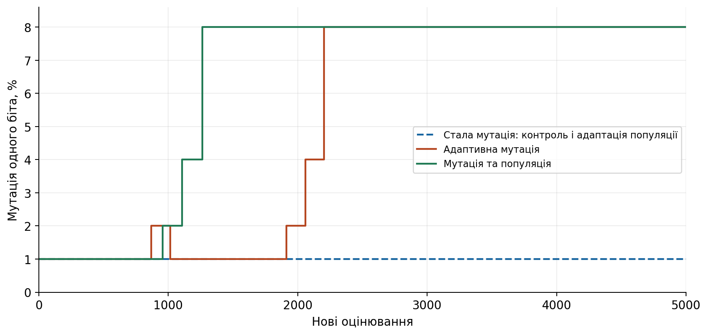
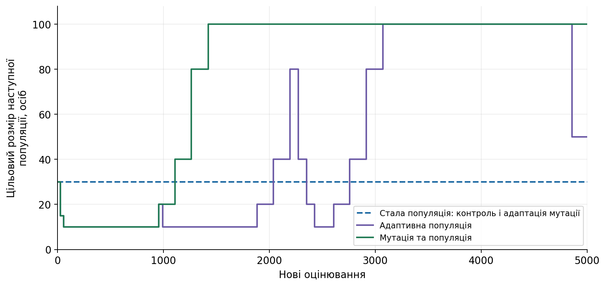
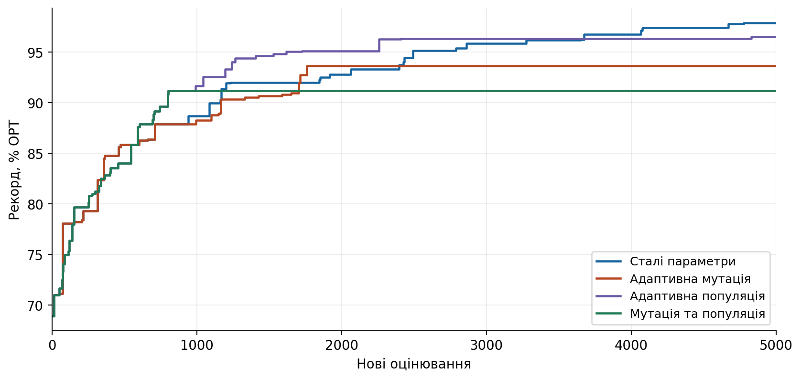
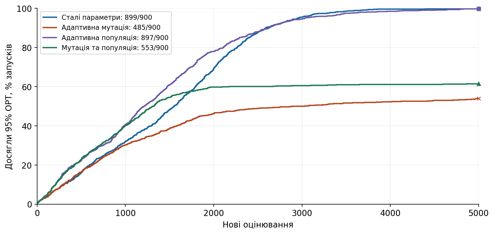
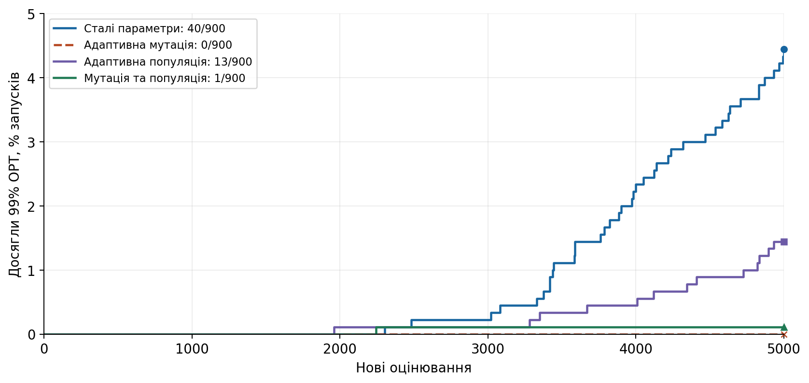
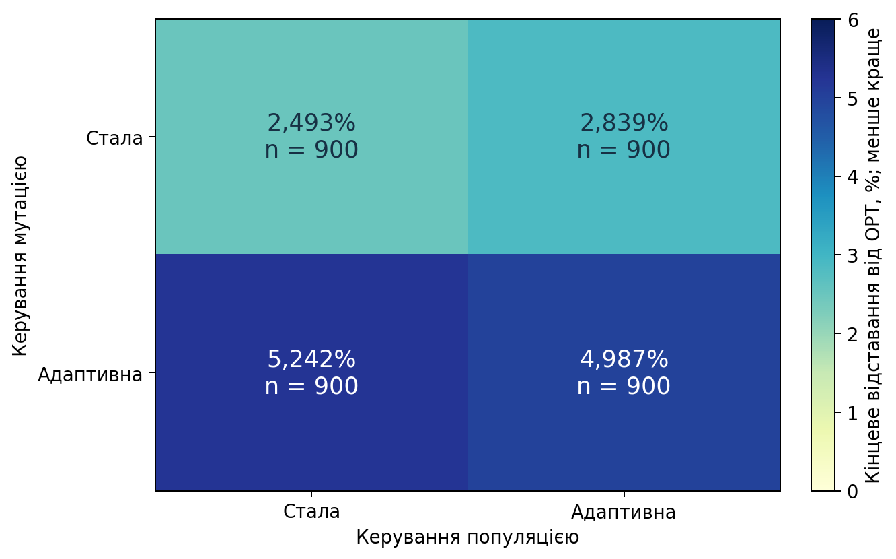

# Мутація та популяція: вторинний описовий аналіз

Новий пошук ГА не виконувався. Перераховано 3600 збережених результатів, незалежно відновлено чотири журнали прикладу.
Результати були переглянуті до постановки цього доповнення. Нових первинних перевірок переваги немає.

| Варіант | Відставання, % | Досягли 95% | Досягли 99% |
|---|---:|---:|---:|
| Сталі параметри | 2,4927 | 899/900 | 40/900 |
| Адаптивна мутація | 5,2421 | 485/900 | 0/900 |
| Адаптивна популяція | 2,8387 | 897/900 | 13/900 |
| Мутація та популяція | 4,9873 | 553/900 | 1/900 |

Спільна адаптація описово краща за адаптацію лише мутації. Сталий контроль має найменше середнє відставання серед чотирьох варіантів.
Окремий приклад не замінює підсумків усіх запусків. Висновок обмежений заданими правилами, задачами й бюджетом.

