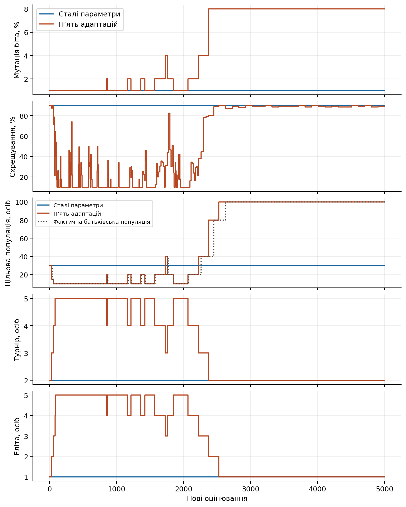
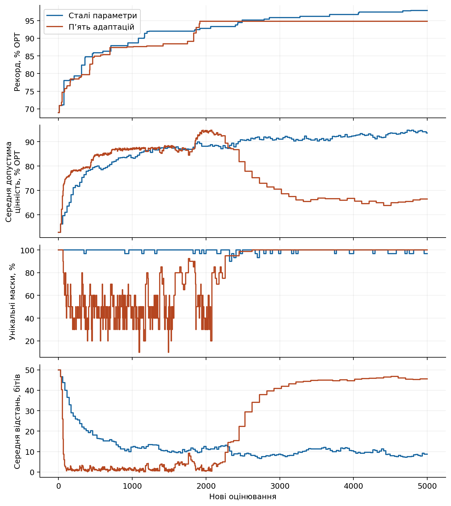
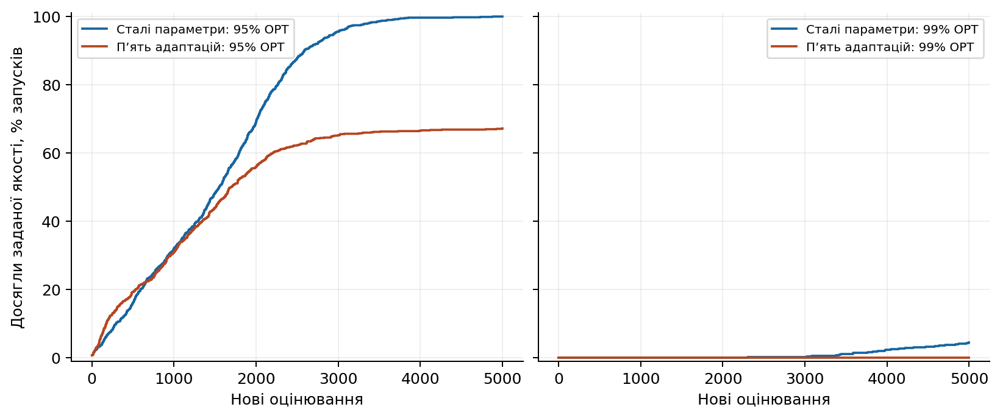
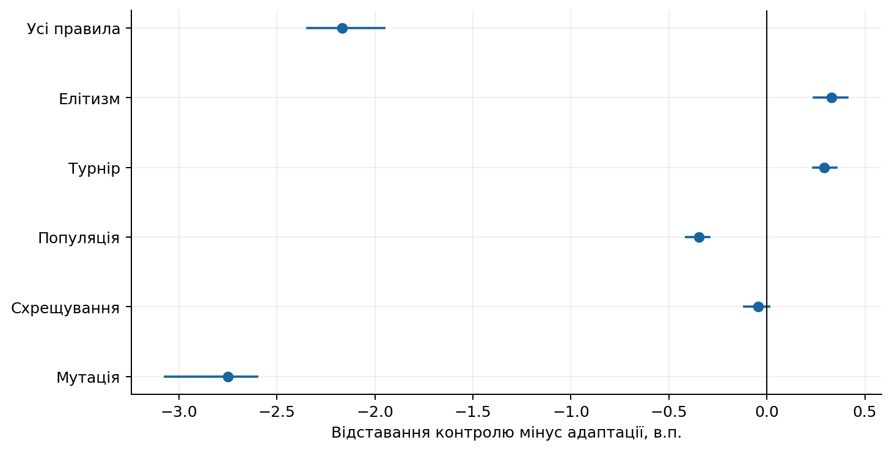
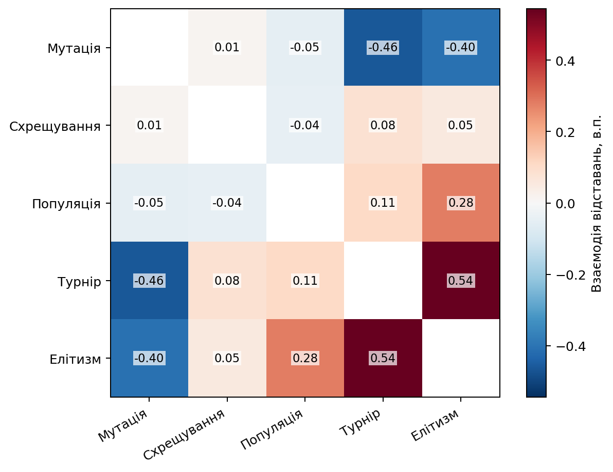
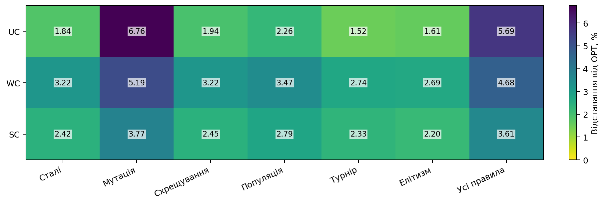

# Еволюція параметрів генетичного алгоритму

## Питання та метод

Як керування мутацією, схрещуванням, популяцією, турнірним відбором та елітизмом змінює пошук розв’язку задачі рюкзака?

Алгоритм формує нове покоління з елітних особин і нащадків. Параметри змінюються лише після завершеного покоління. Новий розмір популяції реалізується звичайним створенням нащадків наступного покоління; усі оцінювання враховано.

## Перевірені результати

Незалежно перевірено 28800 запусків і 144000000 нових оцінювань.

| Початок | Варіант | Запуски | Відставання від оптимуму, % | Досягли 95% | Досягли 99% |
|---|---|---:|---:|---:|---:|
| bank | Сталі параметри | 900 | 2.4927 | 899 | 40 |
| bank | Мутація | 900 | 5.2421 | 485 | 0 |
| bank | Схрещування | 900 | 2.5374 | 900 | 24 |
| bank | Популяція | 900 | 2.8387 | 897 | 13 |
| bank | Турнір | 900 | 2.1986 | 900 | 64 |
| bank | Елітизм | 900 | 2.1630 | 899 | 50 |
| bank | Усі п’ять правил | 900 | 4.6583 | 604 | 0 |

## Активність правил

| Початок | Варіант | Параметр | Зміни у запусках | Збільшення | Зменшення |
|---|---|---|---:|---:|---:|
| bank | Усі правила | p_m | 900/900 | 6857 | 4178 |
| bank | Усі правила | p_c | 900/900 | 58793 | 59188 |
| bank | Усі правила | target_mu | 900/900 | 7776 | 6005 |
| bank | Усі правила | tournament_size | 900/900 | 6765 | 6744 |
| bank | Усі правила | elite_count | 900/900 | 7657 | 7628 |

## Динаміка та якість

Рисунок 1. Застосовані параметри за кількістю нових оцінювань у наперед визначеному прикладі. Цільовий і фактичний розміри популяції показано окремо.

Рисунок 2. Рекорд, середня допустима цінність і два показники різноманітності. Популяційні показники стосуються лише завершених поколінь.

Рисунок 3. Частка досягнення 95% і 99% точного оптимуму з випадкового початку. Недосягнення залишено в знаменнику; сімейства мають рівну вагу.

Рисунок 4. Шість первинних порівнянь з інтервалами BCa рівня 1 − 0,05/6. Додатний ефект означає менше відставання адаптивного варіанта.

Рисунок 5. Описові попарні взаємодії: g₁₁ − g₁₀ − g₀₁ + g₀₀. Інші три механізми усереднено. Від’ємне значення означає нижче відставання, ніж адитивне очікування.

Рисунок 6. Кінцева якість за типом задачі для сталого контролю, п’яти окремих адаптацій і спільного керування. Випадковий початок.

## Межі висновків

Шість первинних ефектів порівнюють окремі адаптації та спільне керування зі сталим контролем. Взаємодії решти поєднань мають описовий характер.

Власні правила є наперед визначеними евристиками. Нова маска, більша різноманітність і довгий застій самі по собі не доводять покращення або локальної оптимальності. Час пошуку, запису та незалежної перевірки вимірюється окремо; внутрішні складові часу не додаються повторно.
