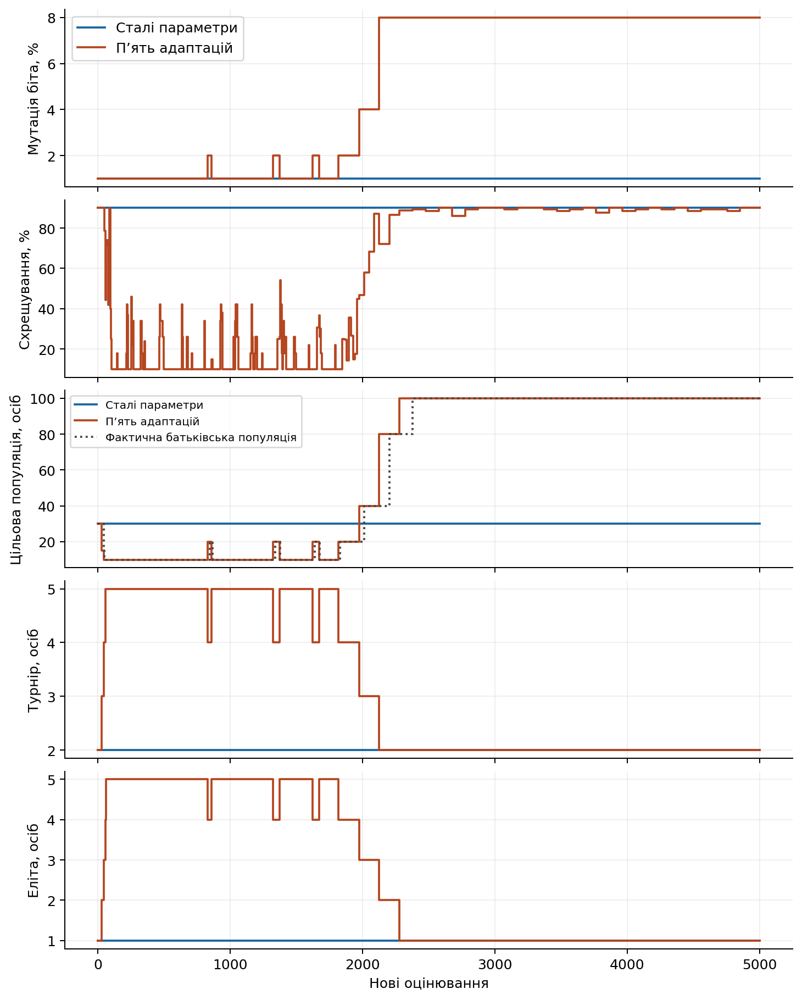
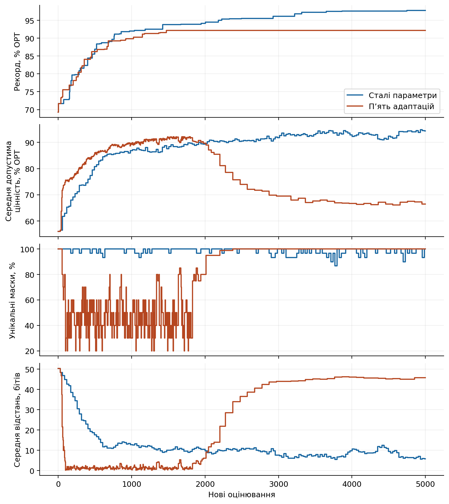
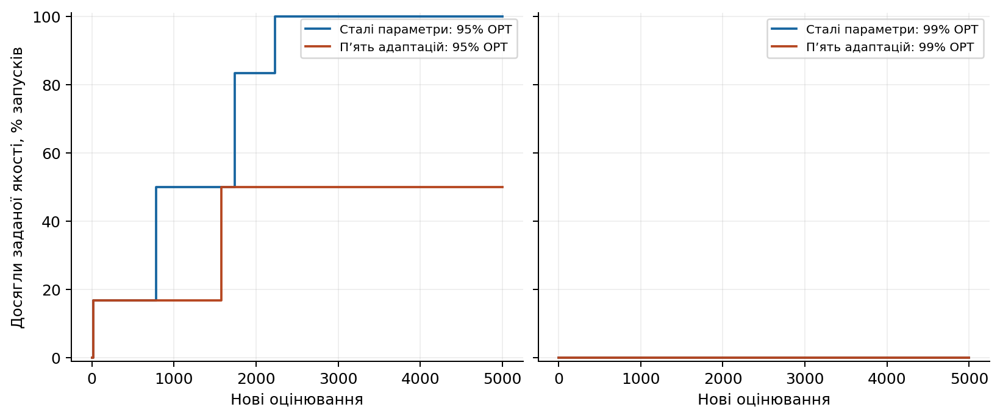
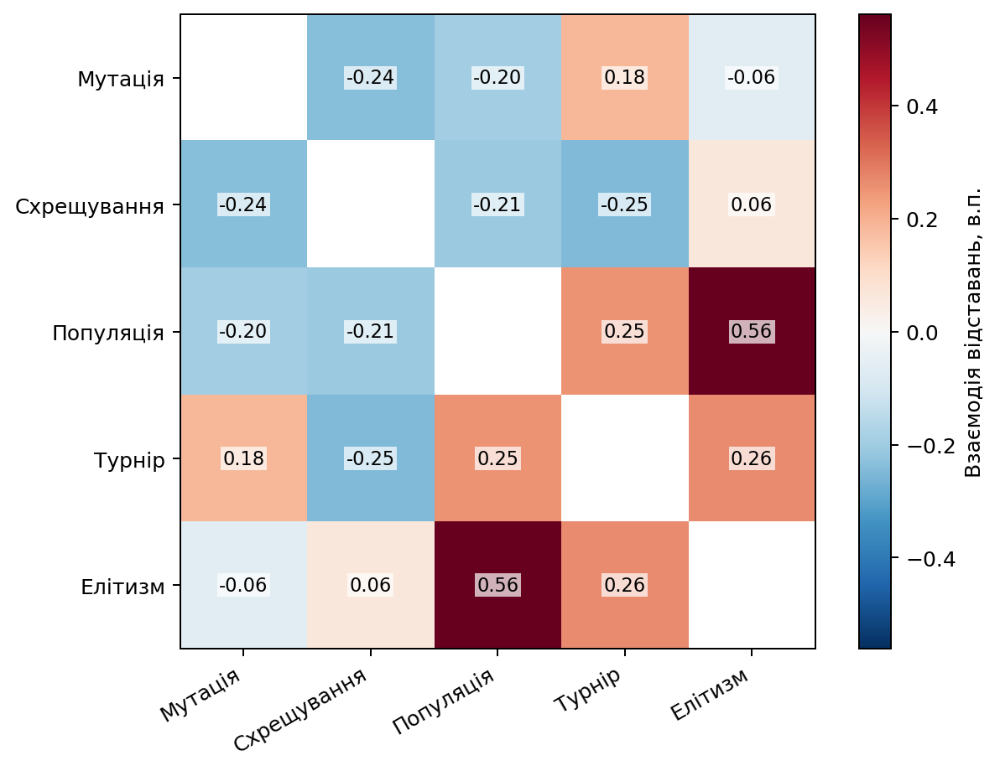
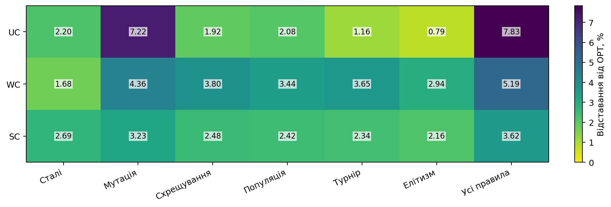

# Еволюція параметрів генетичного алгоритму

## Питання та метод

Як керування мутацією, схрещуванням, популяцією, турнірним відбором та елітизмом змінює пошук розв’язку задачі рюкзака?

Алгоритм формує нове покоління з елітних особин і нащадків. Параметри змінюються лише після завершеного покоління. Новий розмір популяції реалізується звичайним створенням нащадків наступного покоління; усі оцінювання враховано.

## Перевірені результати

Незалежно перевірено 256 запусків і 1280000 нових оцінювань.

| Початок | Варіант | Запуски | Відставання від оптимуму, % | Досягли 95% | Досягли 99% |
|---|---|---:|---:|---:|---:|
| bank | Сталі параметри | 4 | 2.2999 | 4 | 0 |
| bank | Мутація | 4 | 4.3779 | 3 | 0 |
| bank | Схрещування | 4 | 2.8599 | 4 | 0 |
| bank | Популяція | 4 | 2.7396 | 4 | 0 |
| bank | Турнір | 4 | 2.5849 | 4 | 0 |
| bank | Елітизм | 4 | 2.2684 | 4 | 1 |
| bank | Усі п’ять правил | 4 | 4.9780 | 2 | 0 |
| cloned | Сталі параметри | 4 | 0.0578 | 4 | 4 |
| cloned | Мутація | 4 | 0.0578 | 4 | 4 |
| cloned | Схрещування | 4 | 0.0481 | 4 | 4 |
| cloned | Популяція | 4 | 0.0578 | 4 | 4 |
| cloned | Турнір | 4 | 0.0578 | 4 | 4 |
| cloned | Елітизм | 4 | 0.0578 | 4 | 4 |
| cloned | Усі п’ять правил | 4 | 0.0578 | 4 | 4 |

## Активність правил

| Початок | Варіант | Параметр | Зміни у запусках | Збільшення | Зменшення |
|---|---|---|---:|---:|---:|
| bank | Усі правила | p_m | 4/4 | 31 | 20 |
| bank | Усі правила | p_c | 4/4 | 256 | 248 |
| bank | Усі правила | target_mu | 4/4 | 35 | 28 |
| bank | Усі правила | tournament_size | 4/4 | 32 | 31 |
| bank | Усі правила | elite_count | 4/4 | 36 | 35 |
| cloned | Усі правила | p_m | 4/4 | 12 | 0 |
| cloned | Усі правила | p_c | 4/4 | 127 | 92 |
| cloned | Усі правила | target_mu | 4/4 | 8 | 0 |
| cloned | Усі правила | tournament_size | 0/4 | 0 | 0 |
| cloned | Усі правила | elite_count | 0/4 | 0 | 0 |

## Динаміка та якість

Рисунок 1. Застосовані параметри за кількістю нових оцінювань у наперед визначеному прикладі. Цільовий і фактичний розміри популяції показано окремо.

Рисунок 2. Рекорд, середня допустима цінність і два показники різноманітності. Популяційні показники стосуються лише завершених поколінь.

Рисунок 3. Частка досягнення 95% і 99% точного оптимуму з випадкового початку. Недосягнення залишено в знаменнику; сімейства мають рівну вагу.

Рисунок 4. Описові попарні взаємодії: g₁₁ − g₁₀ − g₀₁ + g₀₀. Інші три механізми усереднено. Від’ємне значення означає нижче відставання, ніж адитивне очікування.

Рисунок 5. Кінцева якість за типом задачі для сталого контролю, п’яти окремих адаптацій і спільного керування. Випадковий початок.

## Межі висновків

Один технічний повтор перевіряє правильність реалізації, активність правил і ресурси. Він не встановлює переваги, статистичної стійкості чи наукової новизни. Підтверджувальні інтервали не обчислювалися.

Власні правила є наперед визначеними евристиками. Нова маска, більша різноманітність і довгий застій самі по собі не доводять покращення або локальної оптимальності. Час пошуку, запису та незалежної перевірки вимірюється окремо; внутрішні складові часу не додаються повторно.

## Наступний етап

Прогноз основної серії становить 1735 runner-хвилин із резервуванням. Обробку нових джерельних задач ще не виміряно. Кошторис не є дозволом основної серії.
