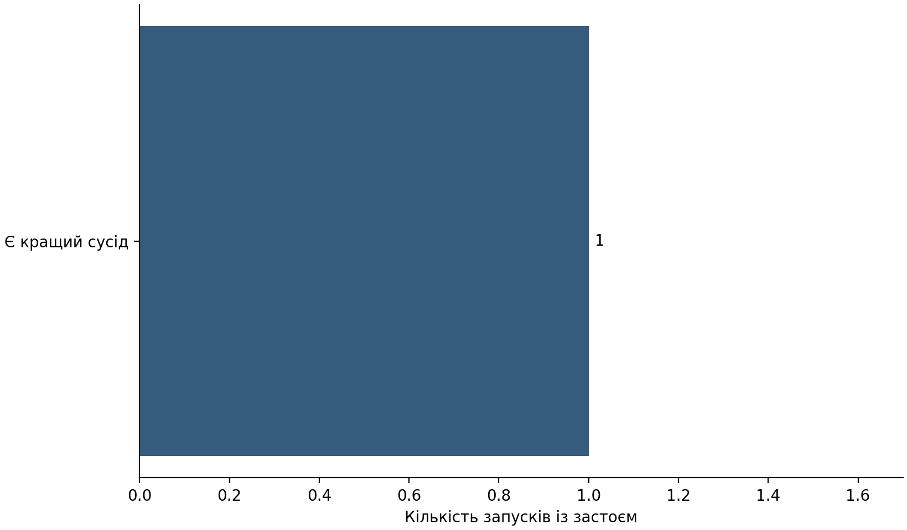
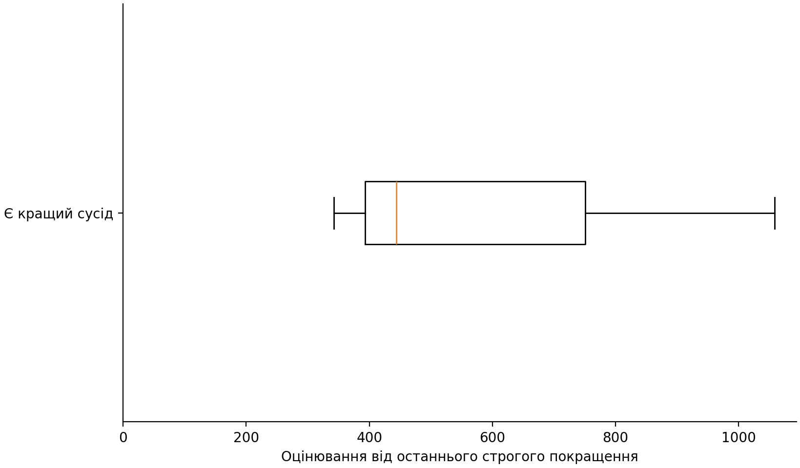
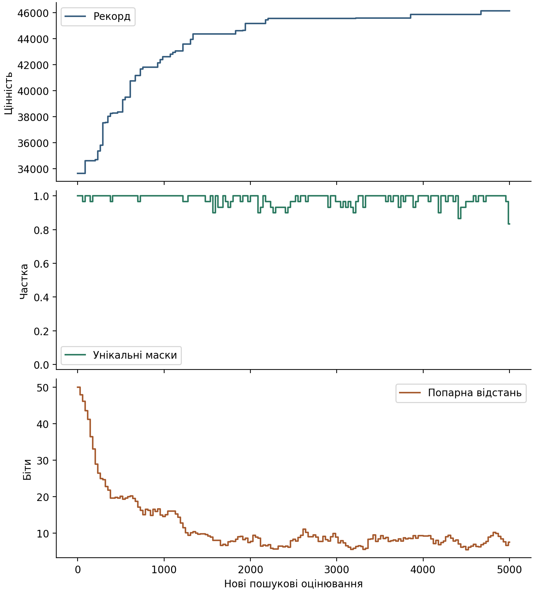

# Застій і локальна оптимальність у генетичному пошуку

## Питання та гіпотеза

Чи завжди відсутність покращення означає локальну оптимальність збереженого набору? Перевіряється припущення, що серед запусків із застоєм є випадки, у яких існує кращий допустимий одно- або двобітний сусід.

## Метод

Досліджується звичайний генетичний алгоритм для задачі рюкзака зі 100 предметами. Популяція містить 30 особин, мутація біта становить 1%, імовірність схрещування 90%. Застоєм вважається відсутність строгого рекорду протягом щонайменше 1000 нових оцінювань.

Кожний завершений запуск містить 5000 нових оцінювань. Початкові 30 оцінок обліковуються окремо. Після пошуку незалежно перевіряються всі 5050 одно- й двобітних сусідів збережених масок. Діагностика не керує пошуком.

## Результати

Незалежно перевірено 3 із 3 запланованих запусків відповідного етапу.

Наведено лише технічні проби з одним технічним початковим значенням генератора. Вони перевіряють реалізацію та ресурсні витрати, а не підтверджують гіпотезу для основної серії з 900 запусків.

| Перевірений стан | Усі завершені запуски | Запуски із застоєм |
|---|---:|---:|
| Є кращий сусід | 3 | 1 |
| Строгий локальний максимум | 0 | 0 |
| Нестрогий локальний максимум | 0 | 0 |
| Глобальний оптимум | 0 | 0 |

Кращий сусід виявлено у 1 із 1 перевірених випадків застою. Відношення сімейно-зважених кількостей становить 100,00%.

Спочатку усереднюються повторення задачі, потім задачі сімейства. Сімейства отримують однакову вагу. Підсумок є відношенням зважених кількостей, а не середнім умовних часток сімейств.

| Сімейство | Перевірені запуски | Застій із кращим сусідом | Усі випадки застою |
|---|---:|---:|---:|
| s000 | 2 | 0 | 0 |
| s005 | 1 | 1 | 1 |



Рисунок 1. Склад перевірених станів серед запусків із застоєм на завершенні пошуку.



Рисунок 2. Тривалість застою залежно від незалежно перевіреного стану збереженої маски.



Рисунок 3. Технічна ілюстрація UC-s000, seed 92999: рекорд і різноманітність останньої завершеної популяції. Оцінені нащадки неповного покоління впливають на рекорд, але не на склад цієї популяції.

## Обмеження та висновок

Сертифікат стосується конкретної збереженої маски, а не всієї популяції. Рівноцінний сусід не доводить замкненості всього плато. Застій не є самостійним доказом локальної або глобальної оптимальності.

Технічні результати не встановлюють частоти станів у майбутній основній серії. Її запуск потребує окремого погодження виміряного кошторису.

## Додаток. Походження та ресурсні витрати

Технічні ідентифікатори та часові вимірювання наведено окремо від наукового викладу.

```json
{
  "provenance": {
    "protocol_id": "GA-KNAPSACK-STAGNATION-DIAGNOSIS-V1",
    "registration_commit_sha": "f5e965d3cb7ca1c9450f40576400d0410e421edf",
    "implementation_commit_sha": "79fe6a9e02d205abe0d9ed8dd3f9e888b849139c",
    "protocol_sha256": "47b51a746744034231e9fcbbbccf2a09c1f1d5b4ce9ef7449e88fbb99834c446",
    "implementation_fingerprint": "bbe9cf6b252eca08bd40cfd1b830a3b87a94b91b33b9b0fb05a7c2daf9c72197",
    "data_manifest_sha256": "528fee8da7d7cb776fb851e6a05949133830e9533c4091cbb4e8698ac19fb0df",
    "registry_sha256": "7e9b8fc893889426e2d3b57610e3a91c09263fcdff488cf15a2b84efe1bdc70f",
    "run_id": 39418960487,
    "run_attempt": 1,
    "environment": {
      "implementation": "CPython",
      "python": "3.12.14",
      "packages": {
        "contourpy": "1.4.0",
        "cycler": "0.12.1",
        "fonttools": "4.66.1",
        "kiwisolver": "1.5.1",
        "matplotlib": "3.10.3",
        "numpy": "2.2.6",
        "packaging": "26.3",
        "pillow": "12.3.0",
        "pyparsing": "3.3.3",
        "python-dateutil": "2.9.0.post0",
        "six": "1.17.0"
      },
      "lock_sha256": "9907e3a46971303d8285b7ae160b5b8eafcab9942565d376bd038a92789745c6"
    },
    "bank_manifest_sha256": "a1d8fc9b151d4a229727cfea209bb55b9d09f592a1511c3028df55f4929eba08"
  },
  "completeness": {
    "status": "COMPLETE",
    "expected": 3,
    "received": 3,
    "verified_complete": 3,
    "missing": [],
    "incomplete": []
  },
  "quote": {
    "status": "MEASURED_PLANNING_ESTIMATE",
    "authorized": false,
    "main_runs": 900,
    "main_new_evaluations": 4500000,
    "max_measured_run_seconds": 2.7875488140000186,
    "max_measured_run_bytes": 5085094,
    "max_measured_aggregation_replay_seconds": 0.7917306239999959,
    "per_run_worker_plus_aggregation_bound_seconds": 3.5792794380000146,
    "runtime_reserve_factor": 1.5,
    "byte_reserve_factor": 1.25,
    "proposed_worker_jobs": 30,
    "startup_minutes_per_worker": 2,
    "service_runner_minutes": 10,
    "estimated_runner_minutes": 151,
    "estimated_bytes": 5720730750,
    "limits": "Three technical cases do not bound all instance costs; approval and runtime enforcement remain mandatory."
  }
}
```
