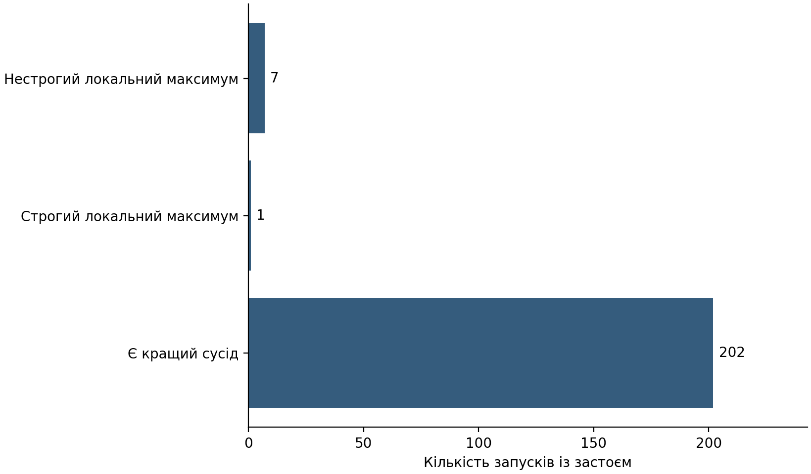
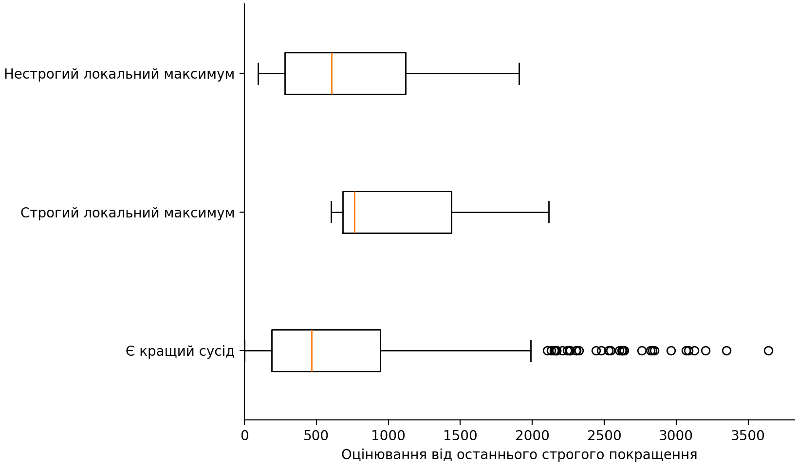
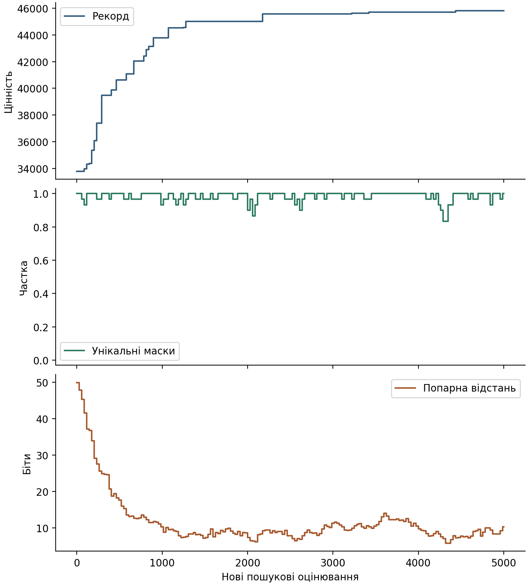

# Чи означає застій генетичного алгоритму локальний максимум?

## Питання та гіпотеза

Перевіряється, чи збережений найкращий набір справді є локальним максимумом, коли пошук тривалий час не дає нового рекорду. Гіпотеза передбачає наявність випадків застою, для яких існує кращий допустимий одно- або двобітний сусід.

## Метод дослідження

Використано 30 задач рюкзака зі 100 предметами та по 30 незалежно ініціалізованих повторень. Досліджується одна стала конфігурація звичайного поколіннєвого генетичного алгоритму: популяція 30, мутація біта 1%, рівномірне схрещування з імовірністю 90%, два турніри по двоє та одна еліта.

Початкова популяція містить порожню маску та 29 випадкових. Її 30 відомих оцінок обліковуються окремо від 5000 нових пошукових оцінювань. Дублікати та недопустимі набори враховуються; виправлення наборів, рестарти й пошукове кешування не застосовуються.

Тривалість застою дорівнює різниці між поточним номером нового оцінювання та моментом останнього строгого рекорду. Якщо початковий рекорд не поліпшився, його момент дорівнює нулю. Порогом застою є 1000 оцінювань. Це операційне визначення, а не критерій оптимальності [1].

На точках 0, 1000, 2500 і 5000 збережено маску-рекорд, завершену популяцію та оцінених нащадків незавершеного покоління. Після пошуку незалежно перевірено всі 5050 одно- й двобітних сусідів кожної унікальної маски-рекорду. Глобальність установлювалася зіставленням з уже підтвердженим точним оптимумом. Діагностика не керувала пошуком.

Останні 12 нащадків після 172 повних поколінь ураховано в рекорді, але незавершену заміну популяції не застосовано. Різноманітність виміряно часткою унікальних масок і середньою попарною відстанню Геммінга, включно з парами однакових масок.

## Результати

Незалежно перевірено 900 із 900 запланованих запусків. Новий пошук містить 4500000 оцінювань; відомі початкові оцінки обліковано окремо.

Таблиця 1. Незалежно перевірений стан збереженого рекорду наприкінці пошуку

| Стан | Усі перевірені запуски | Із застоєм |
|---|---:|---:|
| Є кращий сусід | 872 | 202 |
| Строгий локальний максимум | 3 | 1 |
| Нестрогий локальний максимум | 25 | 7 |
| Глобальний оптимум | 0 | 0 |

У 202 із 210 випадків застою збережена маска мала кращого допустимого сусіда. Сімейно-зважена частка становить 96,19%.

Спочатку усереднено повторення задачі, потім задачі сімейства. Десять сімейств отримали рівну вагу. Підсумок є відношенням зважених кількостей, не середнім умовних часток. Абсолютні кількості наведено поряд із часткою.

Таблиця 2. Випадки застою та доступного покращення за сімействами

| Сімейство | Запуски | Застій із кращим сусідом | Усі випадки застою | Частка серед застою |
|---|---:|---:|---:|---:|
| s000 | 90 | 22 | 23 | 95,65% |
| s001 | 90 | 23 | 23 | 100,00% |
| s002 | 90 | 19 | 19 | 100,00% |
| s003 | 90 | 23 | 23 | 100,00% |
| s004 | 90 | 18 | 18 | 100,00% |
| s005 | 90 | 16 | 16 | 100,00% |
| s006 | 90 | 19 | 21 | 90,48% |
| s007 | 90 | 19 | 23 | 82,61% |
| s008 | 90 | 19 | 20 | 95,00% |
| s009 | 90 | 24 | 24 | 100,00% |

Рисунок 1. Склад перевірених станів серед запусків із застоєм на завершенні пошуку.

Рисунок 2. Тривалість застою залежно від незалежно перевіреного стану збереженої маски.

Рисунок 3. Наперед визначений приклад UC-s000, seed 93001: рекорд і різноманітність останньої завершеної популяції. Оцінені нащадки неповного покоління впливають на рекорд, але не на склад цієї популяції.

## Обмеження

Поріг 1000 оцінювань обрано до основних запусків; інші пороги не підбиралися. Висновки стосуються однієї конфігурації, визначених початків, 30 задач і бюджету 5000 нових оцінювань. Сімейна структура врахована під час усереднення, але не доводить незалежності всіх властивостей задач.

Локальність визначається щодо заданого одно- й двобітного сусідства [2]. Нестрогий локальний максимум із рівноцінним сусідом не є доказом замкненості всього плато. Сертифікат маски не поширюється на всю популяцію. Плоска траєкторія сама по собі не підтверджує локальності чи глобальності.

## Висновок

Тривала відсутність нового рекорду не завжди відповідала локальній оптимальності. У 202 із 210 випадків застою збережений набір усе ще мав допустиме одно- або двобітне покращення. Частка за зареєстрованим сімейним зважуванням становить 96,19%. Отже, для розрізнення застою та локального максимуму потрібна перевірка сусідства, а не лише спостереження за рекордом.

Результат є описовою емпіричною оцінкою. Відмінність між застоєм і локальною оптимальністю не заявляється як новизна. Нових перевірок переваги, p-значень, бутстрепу або добору сприятливих випадків не проводилося.

## Джерела

1. Rajabi A., Witt C. Stagnation Detection in Highly Multimodal Fitness Landscapes. Algorithmica, 2024. https://doi.org/10.1007/s00453-024-01249-w

2. Verel S., Ochoa G., Tomassini M. Local Optima Networks of NK Landscapes with Neutrality. IEEE Transactions on Evolutionary Computation, 2011. https://doi.org/10.1109/TEVC.2010.2046175

## Додаток. Походження результатів

Запуск: https://github.com/ChepaMaksym/GA-article-test/actions/runs/39465647096

Повні журнали, початки, сертифікати, хеші транспортних архівів і внутрішніх файлів збережено окремо. Попередні технічні проби до основної частоти не включено. Історичне ядро та наявний диплом не змінено.
