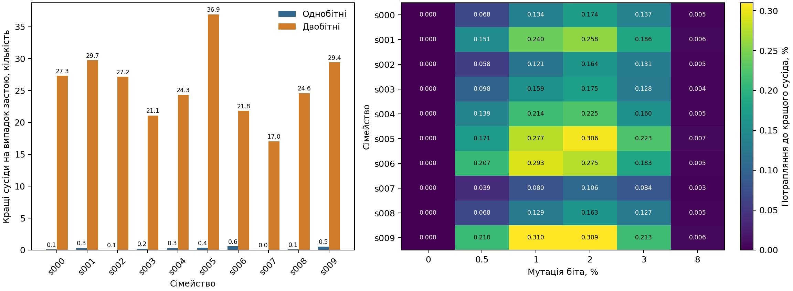
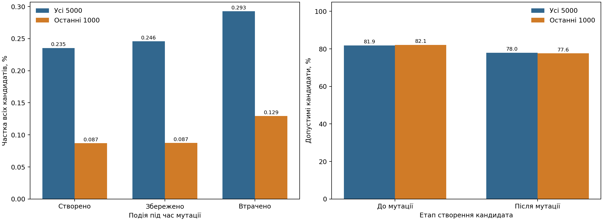
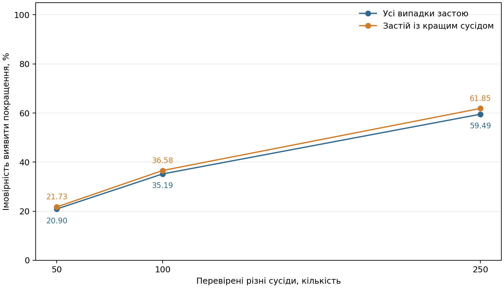

# Доступність покращень і причини застою генетичного алгоритму

## Питання та метод

Перевірено, скільки кращих допустимих сусідів залишається біля збереженого рекорду, як схрещування й мутація змінюють кандидатів та наскільки часто вибіркова перевірка здатна виявити доступне покращення.

Вторинний аналіз використовує вже завершені 900 запусків звичайного генетичного алгоритму на 30 задачах рюкзака зі 100 предметами. Популяція дорівнює 30, мутація біта становить 1%, імовірність рівномірного схрещування 90%. Нового пошуку, адаптації параметрів і повторного визначення точних оптимумів не виконано.

Попередні результати були відомі до постановки додаткових питань. Тому наведені залежності є дослідницькими, а не новою підтверджувальною перевіркою гіпотези. Усереднено повторення задачі, потім задачі сімейства; десять сімейств мають рівну вагу. Умовні показники отримано як відношення зваженого чисельника й знаменника.

## Доступність покращень

Відновлено 900 запусків. Застій тривалістю щонайменше 1000 оцінювань зафіксовано у 210 випадках; у 202 із них існував кращий допустимий одно- або двобітний сусід. Сімейно-зважена частка дорівнює 96,19%. Випадки без кращих сусідів не вилучено.

Таблиця 1. Доступні покращення наприкінці пошуку

| Вибірка | Запуски | Однобітні сусіди, середнє | Двобітні сусіди, середнє | Вільна місткість, середнє |
|---|---:|---:|---:|---:|
| Усі запуски | 900 | 0,70 | 40,56 | 56,89 |
| Усі випадки застою | 210 | 0,27 | 25,67 | 32,92 |
| Застій із кращим сусідом | 202 | 0,28 | 26,68 | 34,22 |

Серед випадків застою з доступним покращенням середня найменша додатна зміна цінності становить 4,38, а середня найбільша 138,02. Це середні за окремими масками, не мінімум і максимум усієї серії.

Таблиця 2. Тип кращого сусіда серед усіх випадків застою

| Зміна набору | Кращі сусіди на випадок застою, середнє |
|---|---:|
| Додавання одного предмета | 0,27 |
| Вилучення одного предмета | 0,00 |
| Обмін одного предмета на інший | 25,64 |
| Додавання двох предметів | 0,03 |
| Вилучення двох предметів | 0,00 |

Нехай b₁ і b₂ означають кількість кращих допустимих сусідів із рівно однією та двома змінами бітів. Для незалежної мутації незмінної маски-рекорду ймовірність потрапити саме до таких сусідів становить:

P≤₂(p) = b₁p(1 − p)⁹⁹ + b₂p²(1 − p)⁹⁸. (1)

Формула враховує точні зміни без додаткових мутацій. Вона не описує весь генетичний алгоритм, інших батьків, схрещування чи переходи з трьома й більше змінами. Найбільше значення цієї моделі не є рекомендацією найкращої мутації для всього пошуку.

Рисунок 1. Кращі одно- й двобітні сусіди та модель мутації маски-рекорду серед усіх випадків застою. Нулі збережено; н/в означає відсутність випадків застою в сімействі. Модель не є прогнозом успіху всього ГА.

## Роль схрещування та мутації

Зі збережених операторних рішень відновлено проміжну маску після схрещування та остаточну маску після мутації. Обидва набори зіставлено з одним допустимим рекордом, відомим безпосередньо перед оцінюванням остаточного кандидата. Проміжні оцінки обчислено після пошуку; вони не керували алгоритмом.

Мутація створює покращення, якщо проміжний набір не перевищував рекорд, а остаточний перевищив. Покращення зберігається, якщо обидва набори перевищують рекорд. Воно втрачається, якщо проміжний набір був кращим, але остаточний став недопустимим або не перевищив рекорд. Збереження не означає незмінності цінності проміжного набору.

Таблиця 3. Події операторів та допустимість, частка кандидатів у відсотках

| Показник | Усі 5000 оцінювань | Останні 1000 оцінювань |
|---|---:|---:|
| Мутація створила покращення | 0,235 | 0,087 |
| Мутація зберегла перевищення рекорду | 0,246 | 0,087 |
| Мутація втратила проміжне покращення | 0,293 | 0,129 |
| Допустимість до мутації | 81,876 | 82,118 |
| Допустимість після мутації | 77,976 | 77,596 |
| Повторно оцінені маски | 5,995 | 6,581 |
| Рекорд вибрано хоча б одним батьком | 13,560 | 14,757 |

Рисунок 2. Події мутації відносно рекорду перед оцінюванням кандидата та допустимість до і після мутації. Збереження означає перевищення попереднього рекорду, не збереження всієї проміжної цінності. Втрата стосується лише неоціненого проміжного набору.

Втрата проміжного покращення не означає відкидання вже оціненого рекорду відбором. Кожний кращий допустимий остаточний кандидат одразу врахований у рекорді, навіть якщо покоління не завершено. Відсутність першої маски-рекорду в завершеній популяції також не доводить помилки елітизму: кандидат може ще належати незавершеному поколінню, а за рівності цінностей може зберігатися інша маска.

## Вибіркова перевірка сусідства

Для рівноймовірної вибірки s різних сусідів із 5050, серед яких b = b₁ + b₂ кращі, імовірність знайти хоча б одне покращення дорівнює:

Pвиявлення(s) = 1 − C(5050 − b, s) / C(5050, s). (2)

Коли s перевищує кількість сусідів без покращення, імовірність дорівнює одиниці. За b = 0 вона дорівнює нулю. Обчислення є точним комбінаторним розрахунком, а не випадковим моделюванням.

Таблиця 4. Імовірність виявлення покращення вибірковою перевіркою, %

| Перевірені сусіди | Усі випадки застою | Застій із кращим сусідом |
|---:|---:|---:|
| 50 | 20,90 | 21,73 |
| 100 | 35,19 | 36,58 |
| 250 | 59,49 | 61,85 |

Рисунок 3. Точна модель випадкової перевірки сусідів без повернення. Перша крива охоплює всі випадки застою, включно з нульовою кількістю покращень; друга умовна на наявності кращого сусіда. Це аналітичні ймовірності, не нові експерименти.

Знайдений кращий сусід спростовує локальність маски у визначеному околі. Відсутність знахідки у неповній вибірці не підтверджує локального максимуму. Для використання діагностики під час нового пошуку її оцінювання потрібно включити до спільного бюджету.

## Наперед визначений приклад

Для задачі UC-s000 використано повторення 93001 незалежно від його результату.

Таблиця 5. Зміна доступності покращень у визначеному повторенні

| Нові оцінювання | Тривалість застою | Кращі однобітні сусіди | Кращі двобітні сусіди | Рекордна маска в популяції |
|---:|---:|---:|---:|---|
| 0 | 0 | 11 | 626 | Так |
| 1000 | 119 | 7 | 143 | Так |
| 2500 | 337 | 0 | 11 | Так |
| 5000 | 590 | 0 | 9 | Так |

## Описові залежності

Коефіцієнти Спірмена обчислено між десятьма сімейними середніми за всіма 900 запусками, не між мільйонами кандидатів і не лише відібраними випадками застою. Для однакових значень використано середні ранги. Сталий ряд має невизначений коефіцієнт, а не нуль.

Таблиця 6. Описовий зв’язок доступності покращень із тривалістю застою

| Показник | Коефіцієнт Спірмена | Сімейства |
|---|---:|---:|
| Кращі однобітні сусіди | -0,170 | 10 |
| Кращі двобітні сусіди | -0,055 | 10 |
| Модельна ймовірність за мутації 1% | -0,079 | 10 |

Ці коефіцієнти не доводять причинного впливу кількості сусідів на застій. Зв’язки між параметрами, прямо задані формулою, не розглядаються як емпіричне відкриття. P-значення, бутстреп та додаткові перевірки переваги не обчислювалися.

## Висновки та обмеження

Наявність кращого сусіда та його фактичне знаходження є різними подіями. Імовірність мутаційного переходу залежить не лише від радіуса зміни, а й від кількості доступних покращень. Перевірка операторних проміжних станів показує, на якому етапі виникає або втрачається перевищення попереднього рекорду.

Наведені результати стосуються однієї сталої конфігурації генетичного алгоритму, визначених задач, початків і бюджету. Повні сертифікати стосуються окремих масок, а не всієї популяції чи замкненості плато. Модель мутації, комбінаторні ймовірності та описові кореляції не підтверджують переваги адаптивного контролера. Наступний експеримент потребує окремого протоколу, контрольованого правила адаптації та обліку вартості діагностики.

## Додаток. Походження й облік

Використано незмінні журнали попередньої серії та незалежні сертифікати одно- й двобітного сусідства. Нових пошукових оцінювань і точних розв’язань не виконано. Повторне обчислення проміжних оцінок є витратою перевірки після пошуку, не прихованим продовженням алгоритму. Первинні висновки попередньої серії не переписано.
