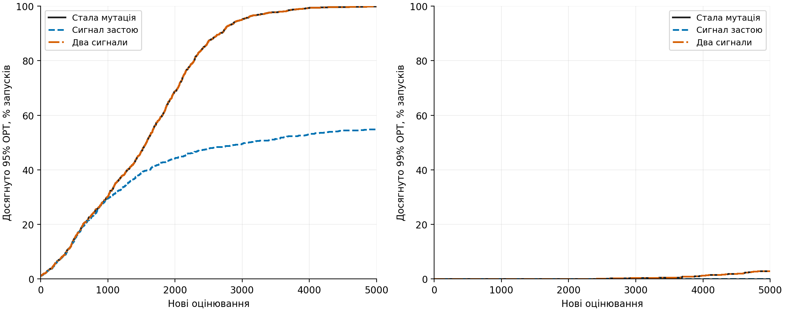
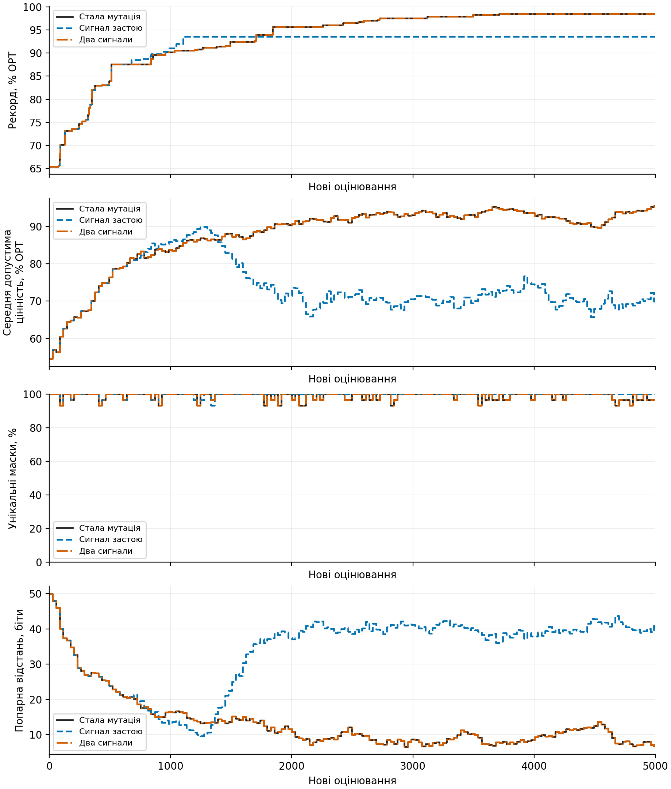
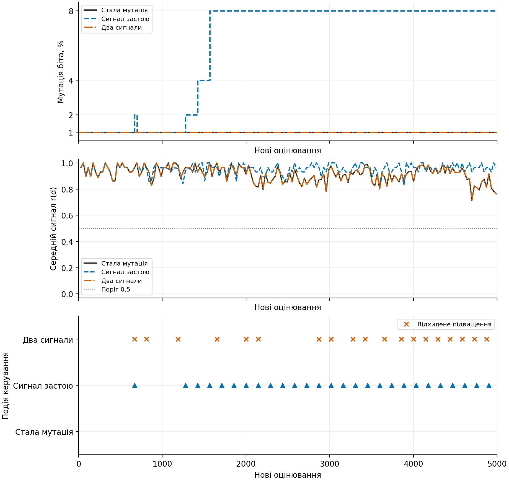
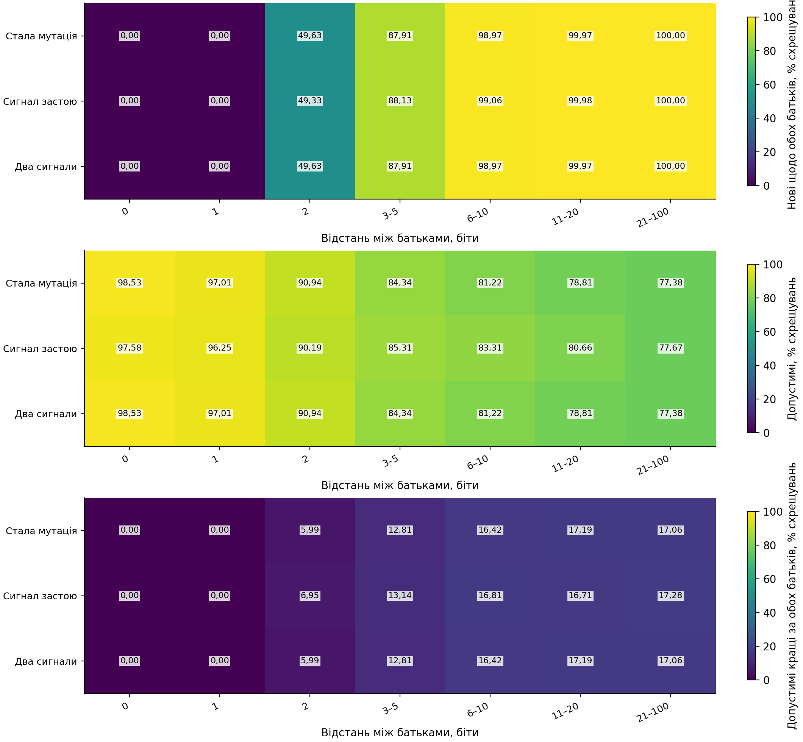
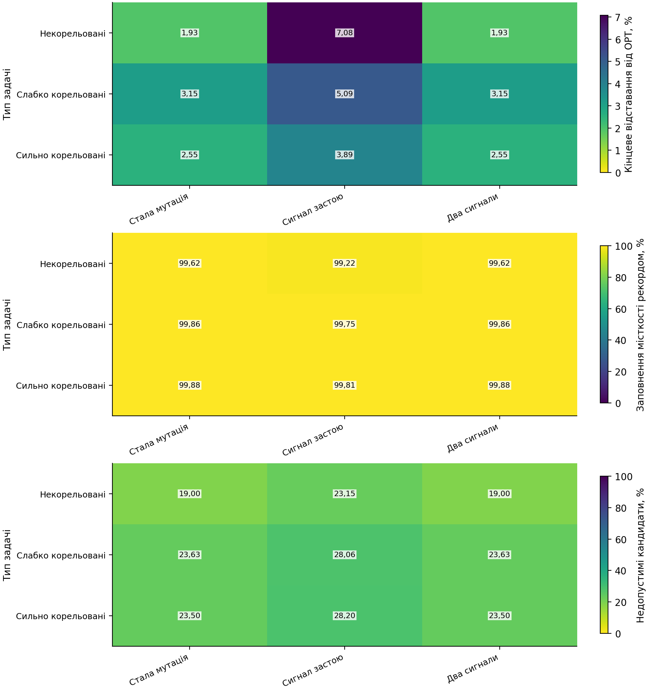

# Два сигнали для керування мутацією

## Перевірені матеріали

Незалежно перевірено 2700 запусків і 13500000 нових оцінювань.

Нова серія порівнює три способи керування одним поколіннєвим генетичним алгоритмом.

## Кінцева якість і час до цілі

| Початок | Керування | Запуски | Відставання від OPT, % | Досягли 95% | Досягли 99% |
|---|---|---:|---:|---:|---:|
| bank | Стала мутація | 900 | 2.5429 | 899/900 | 26/900 |
| bank | Сигнал застою | 900 | 5.3528 | 494/900 | 0/900 |
| bank | Два сигнали | 900 | 2.5429 | 899/900 | 26/900 |

Недосягнення цілі збережено. Відомий початок є точкою 0; кінцевий бюджет становить 5000 нових оцінювань.

## Два первинні порівняння

Додатний ефект означає менше відставання нового варіанта.

| Контроль мінус два сигнали | Ефект, в.п. | Нижня межа 97,5% | Верхня межа 97,5% | Статус |
|---|---:|---:|---:|---|
| fixed_gap_minus_two_signal_gap | 0.0000 | н/в | н/в | DESCRIPTIVE_ONLY |
| adaptive_gap_minus_two_signal_gap | 2.8100 | 2.6844 | 2.9141 | INFERENTIAL_BCA |

Мінімального практично важливого ефекту не задано; статистичний результат не оголошується практичною перевагою автоматично.

## Пояснення рисунків

Рисунок 1. Досягнення однакової якості за кількістю нових оцінювань.

Рисунок 2. Рекорд, середня допустима якість та різноманітність популяції у визначеному прикладі.

Рисунок 3. Фактична мутація, схожість батьків і рішення контролера у визначеному прикладі.

Рисунок 4. Новизна, допустимість і корисність проміжного схрещування за відстанню між батьками.

Рисунок 5. Кінцева якість, заповнення місткості та недопустимі спроби за типом задачі.

## Витрати й обмеження

Окремо збережено час пошуку, обчислення сигналу, контролера, запису та незалежної перевірки. Спостереження сигналу у сталому контролі є витратою дослідження, не обов'язковою частиною алгоритму.

Нова маска не обов'язково допустима або краща. Застій та значення сигналу не сертифікують локальний максимум. Повне сусідство в кожному поколінні не перевіряється. Проміжні оцінки схрещування отримано тільки після пошуку.

| Керування | Складова часу | Відомі вимірювання | Середнє, с |
|---|---|---:|---:|
| Стала мутація | search_wall_ns | 900 | 0.288152 |
| Стала мутація | serialization_ns | 900 | 0.438088 |
| Стала мутація | verification_ns | 900 | 0.622956 |
| Стала мутація | controller | 900 | 0.000885 |
| Стала мутація | signal | 900 | 0.049567 |
| Сигнал застою | search_wall_ns | 900 | 0.295265 |
| Сигнал застою | serialization_ns | 900 | 0.887347 |
| Сигнал застою | verification_ns | 900 | 0.633897 |
| Сигнал застою | controller | 900 | 0.000954 |
| Сигнал застою | signal | 900 | 0.052881 |
| Два сигнали | search_wall_ns | 900 | 0.288455 |
| Два сигнали | serialization_ns | 900 | 0.438164 |
| Два сигнали | verification_ns | 900 | 0.623289 |
| Два сигнали | controller | 900 | 0.001353 |
| Два сигнали | signal | 900 | 0.049569 |

Складові часу мають вкладені області й не додаються механічно. Підготовка спільного початку враховується один раз на умову.
