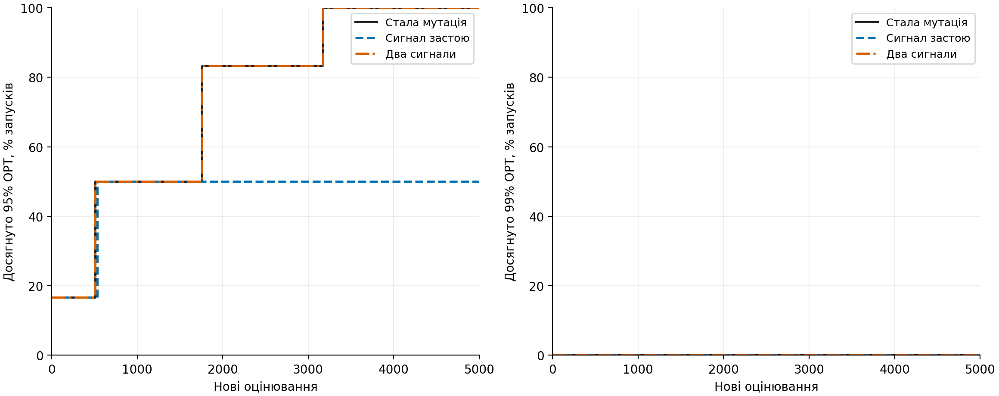
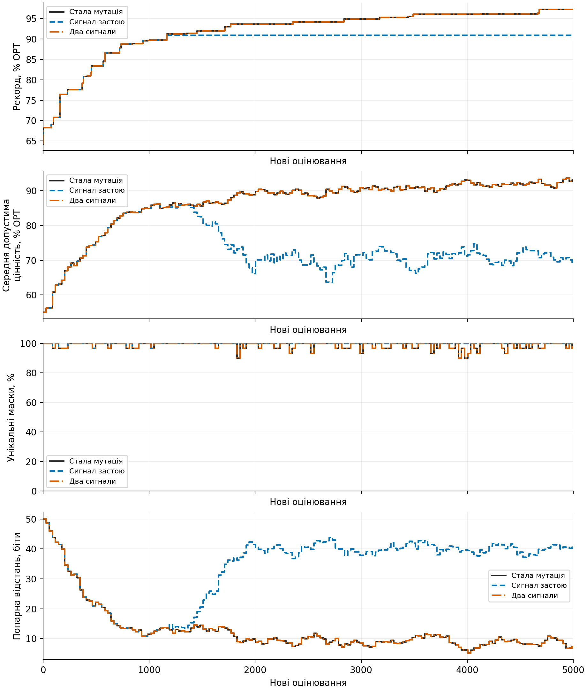
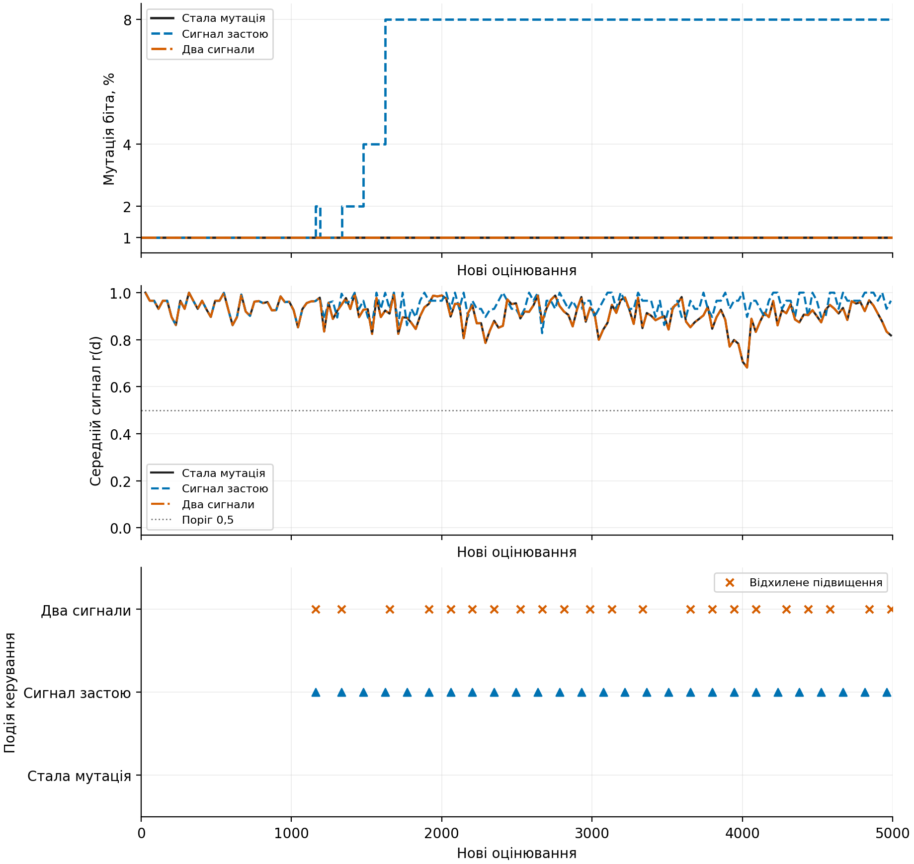
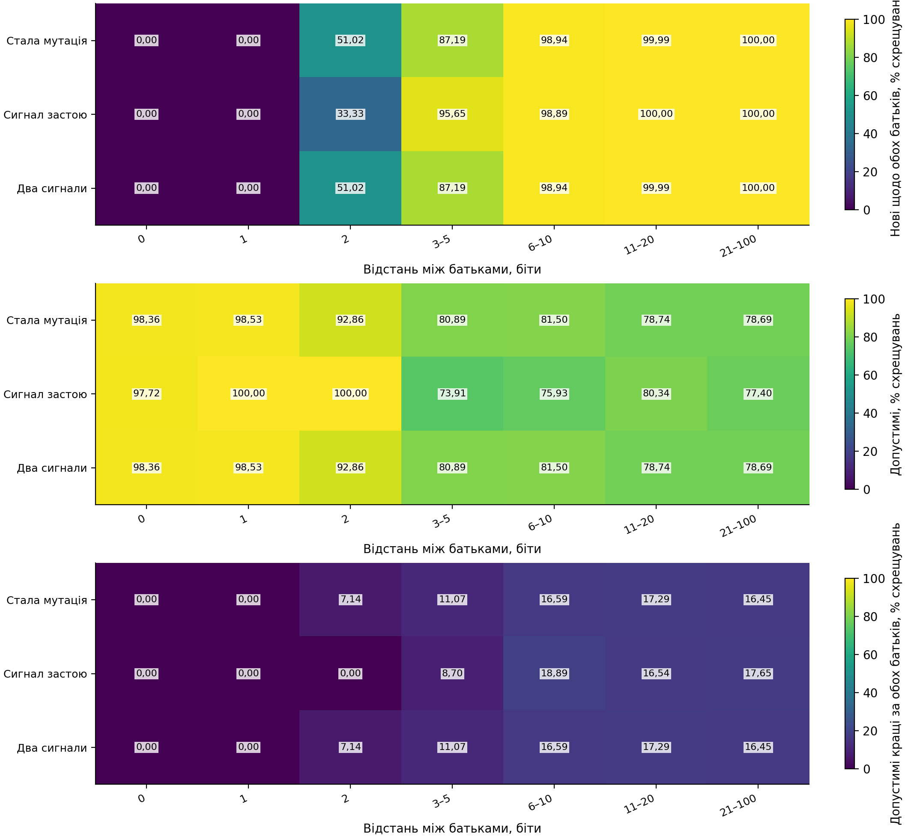
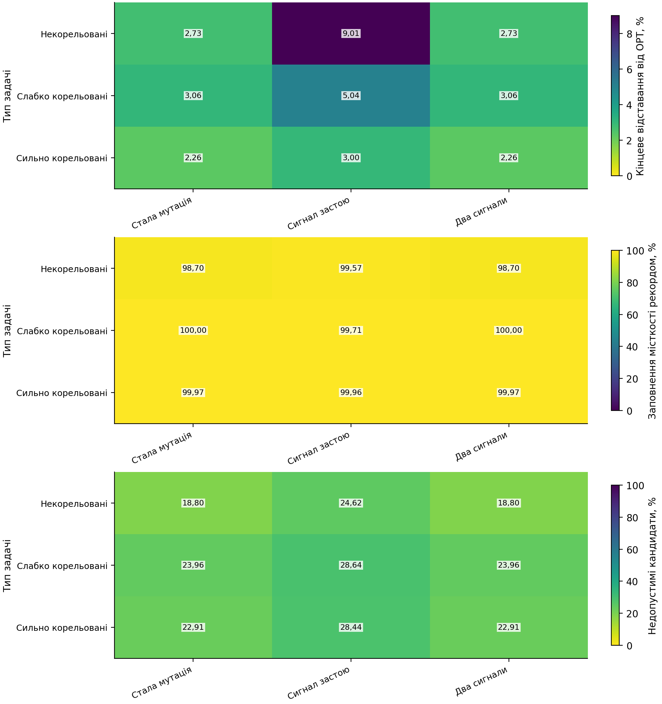

# Два сигнали для керування мутацією

## Перевірені матеріали

Незалежно перевірено 24 запусків і 120000 нових оцінювань.

Технічний пілот перевіряє реалізацію та ресурси, не доводить переваги.

## Кінцева якість і час до цілі

| Початок | Керування | Запуски | Відставання від OPT, % | Досягли 95% | Досягли 99% |
|---|---|---:|---:|---:|---:|
| bank | Стала мутація | 4 | 2.6483 | 4/4 | 0/4 |
| bank | Сигнал застою | 4 | 4.7156 | 2/4 | 0/4 |
| bank | Два сигнали | 4 | 2.6483 | 4/4 | 0/4 |
| cloned | Стала мутація | 4 | 0.0578 | 4/4 | 4/4 |
| cloned | Сигнал застою | 4 | 0.0578 | 4/4 | 4/4 |
| cloned | Два сигнали | 4 | 0.0578 | 4/4 | 4/4 |

Недосягнення цілі збережено. Відомий початок є точкою 0; кінцевий бюджет становить 5000 нових оцінювань.

## Два первинні порівняння

Підтверджувальні інтервали й кореляції не обчислювалися: один технічний seed не є основною серією.

## Пояснення рисунків

Рисунок 1. Досягнення однакової якості за кількістю нових оцінювань.

Рисунок 2. Рекорд, середня допустима якість та різноманітність популяції у визначеному прикладі.

Рисунок 3. Фактична мутація, схожість батьків і рішення контролера у визначеному прикладі.

Рисунок 4. Новизна, допустимість і корисність проміжного схрещування за відстанню між батьками.

Рисунок 5. Кінцева якість, заповнення місткості та недопустимі спроби за типом задачі.

## Витрати й обмеження

Окремо збережено час пошуку, обчислення сигналу, контролера, запису та незалежної перевірки. Спостереження сигналу у сталому контролі є витратою дослідження, не обов'язковою частиною алгоритму.

Нова маска не обов'язково допустима або краща. Застій та значення сигналу не сертифікують локальний максимум. Повне сусідство в кожному поколінні не перевіряється. Проміжні оцінки схрещування отримано тільки після пошуку.

| Керування | Складова часу | Відомі вимірювання | Середнє, с |
|---|---|---:|---:|
| Стала мутація | search_wall_ns | 8 | 0.274541 |
| Стала мутація | serialization_ns | 8 | 0.404261 |
| Стала мутація | verification_ns | 8 | 0.600937 |
| Стала мутація | controller | 8 | 0.000833 |
| Стала мутація | signal | 8 | 0.046210 |
| Сигнал застою | search_wall_ns | 8 | 0.281229 |
| Сигнал застою | serialization_ns | 8 | 0.926242 |
| Сигнал застою | verification_ns | 8 | 0.614323 |
| Сигнал застою | controller | 8 | 0.000916 |
| Сигнал застою | signal | 8 | 0.048090 |
| Два сигнали | search_wall_ns | 8 | 0.278755 |
| Два сигнали | serialization_ns | 8 | 0.405134 |
| Два сигнали | verification_ns | 8 | 0.598108 |
| Два сигнали | controller | 8 | 0.001286 |
| Два сигнали | signal | 8 | 0.048805 |

Складові часу мають вкладені області й не додаються механічно. Підготовка спільного початку враховується один раз на умову.

## Наступний ресурсний етап

Прогноз основної серії: 204 runner-хвилин із резервуванням; це виміряний кошторис, не дозвіл виконання. Потрібне окреме погодження та перевірка обсягу журналів.
